<p align="center">
  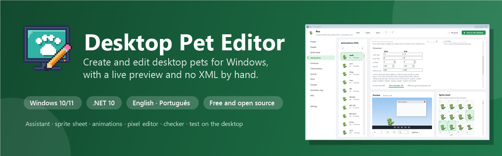
</p>

<p align="center">
  <a href="https://github.com/lfeliipeadv-stack/desktop-pet-editor/releases/latest"></a>
  <a href="https://github.com/lfeliipeadv-stack/desktop-pet-editor/releases"></a>
  
  
  
  <a href="LICENSE"></a>
</p>

<h3 align="center">
  <a href="https://lfeliipeadv-stack.github.io/DeskPals-Editor/">🌐 Open the online editor</a>
  &nbsp;·&nbsp;
  <a href="https://github.com/lfeliipeadv-stack/desktop-pet-editor/releases/latest/download/PetEditor.exe">⬇️ Download PetEditor.exe</a>
  &nbsp;·&nbsp;
  <a href="https://github.com/lfeliipeadv-stack/desktop-pet-editor/wiki">📖 Wiki</a>
  &nbsp;·&nbsp;
  <a href="https://github.com/lfeliipeadv-stack/desktop-pet-editor/wiki/Inicio">🇧🇷 Em português</a>
</h3>

<p align="center">
  Desktop pets are the little animated characters of <a href="https://github.com/lfeliipeadv-stack/meu-pet">DesktopPet</a>
  that walk on your windows, fall on the taskbar and can be picked up with the mouse.<br>
  The <b>Pet Editor</b> makes your own: from a few pictures to a pet that walks, in minutes.
</p>

<p align="center">
  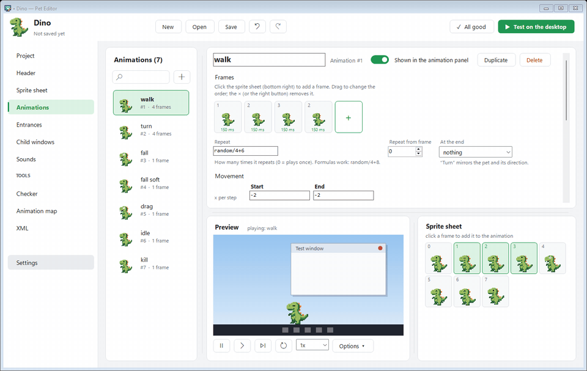
  <br><sub>Eight pictures become a pet in three steps — then it walks in the live preview, with a test window on the stage.</sub>
</p>

---

## 🌐 The online editor

**[lfeliipeadv-stack.github.io/DeskPals-Editor](https://lfeliipeadv-stack.github.io/DeskPals-Editor/)** — the same
editor in the browser, on any computer, with nothing to install. Nothing is uploaded: the pet stays on your computer.

- **Make a pet:** start from a model that already walks, or let the assistant turn your PNG pictures or a GIF into a pet;
  build the sprite sheet from loose pictures and fix it in the pixel editor.
- **Understand it:** the animation map shows what comes after what, every animation shows where it is used, and the
  entrances are described in words.
- **Test it:** the pet runs with the same engine as DeskPals — it walks on a window, falls on the taskbar and can be
  picked up and thrown with the mouse.
- **Share it:** open any pet of the DeskPals gallery, export a `.zip` just like the gallery's (with the animated
  preview), or send yours to the gallery.
- Works offline after the first visit and can be installed as an app. English, Português and Español.

The code is in [`web/`](web) — plain JavaScript, no build step. To try it locally: `node tools/serve.mjs 8080`.

## ✨ Make a pet in three steps

<table>
  <tr>
    <td width="33%" valign="top">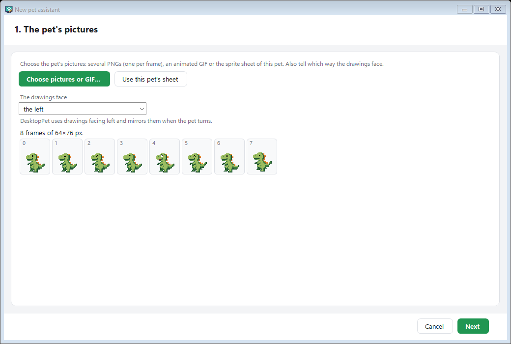<br><b>1. Your pictures</b><br><sub>Several PNGs, an animated GIF or an existing sheet. Drawings facing right are mirrored for you.</sub></td>
    <td width="33%" valign="top">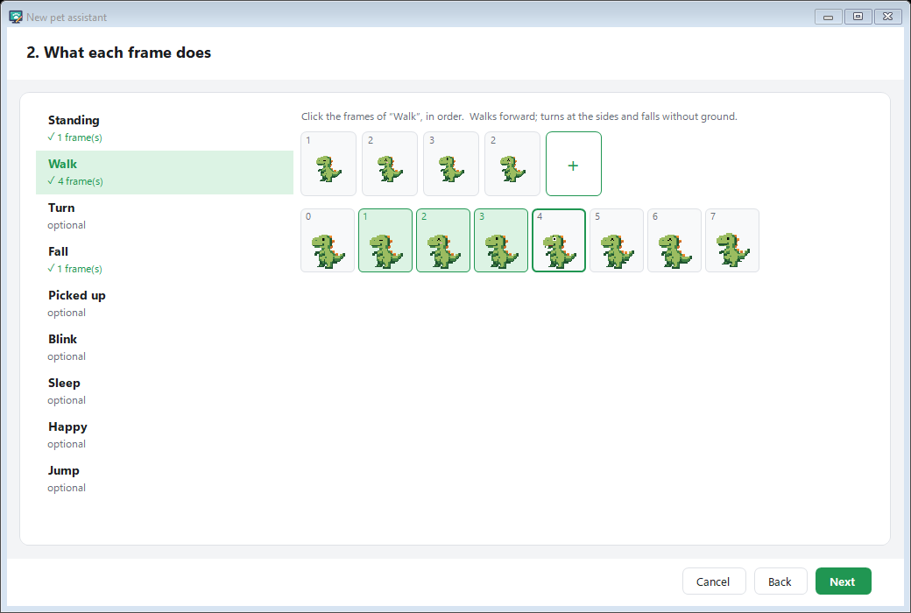<br><b>2. What each frame does</b><br><sub>Click the frames of standing, walking, turning, falling, being picked up… in order.</sub></td>
    <td width="33%" valign="top">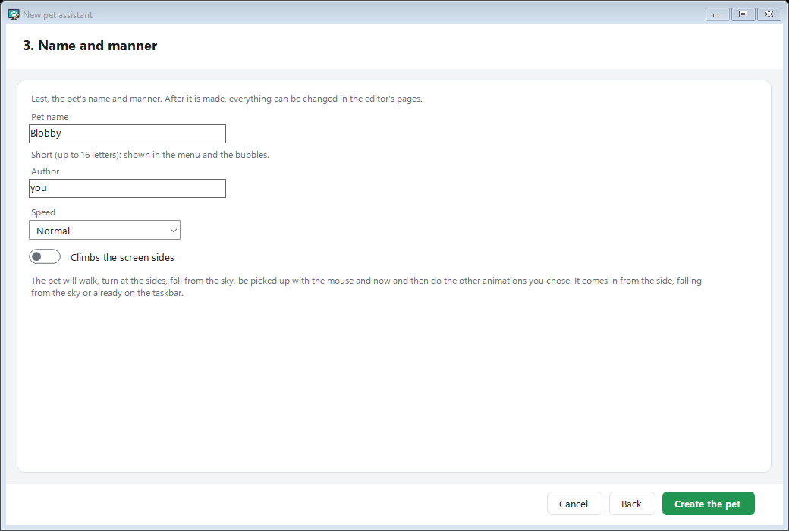<br><b>3. Name and manner</b><br><sub>Name, author, speed. The pet already walks, turns, falls from the sky and comes onto the screen.</sub></td>
  </tr>
</table>

## 🧰 Everything a pet needs, one page each

<table>
  <tr>
    <td width="50%" valign="top">
      
      <h4>🎞️ Animations with a live preview</h4>
      Frames by clicking the sheet, repeat, movement, speed and what comes next — at the end, on a border, without
      ground. The preview plays it like DesktopPet: grab the pet with the mouse, throw it, add a test window, step frame
      by frame.
    </td>
    <td width="50%" valign="top">
      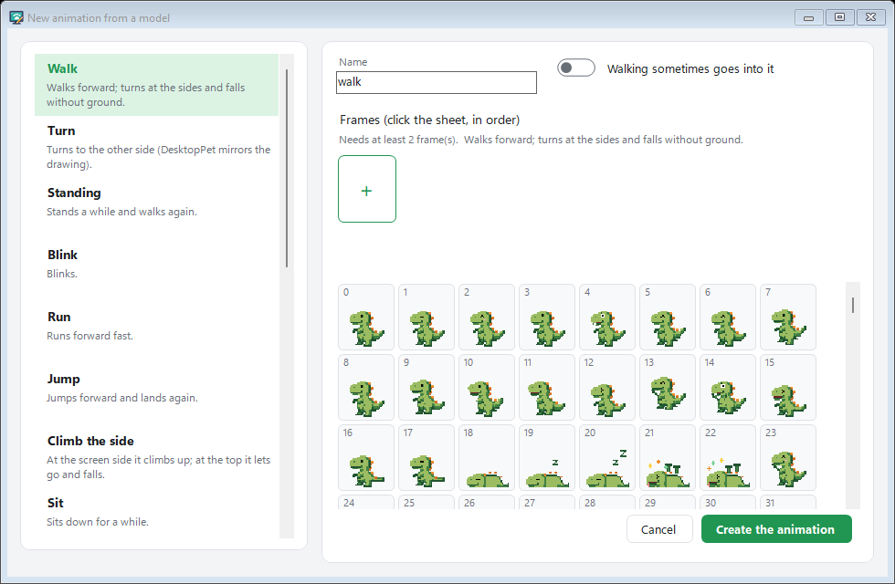
      <h4>🧩 Ready-made animations</h4>
      Walk, turn, run, jump, climb the side, sit, sleep, dance, talk… made from your frames, with their movement and
      next animations already set. Or copy animations (with their frames) from another pet.
    </td>
  </tr>
  <tr>
    <td valign="top">
      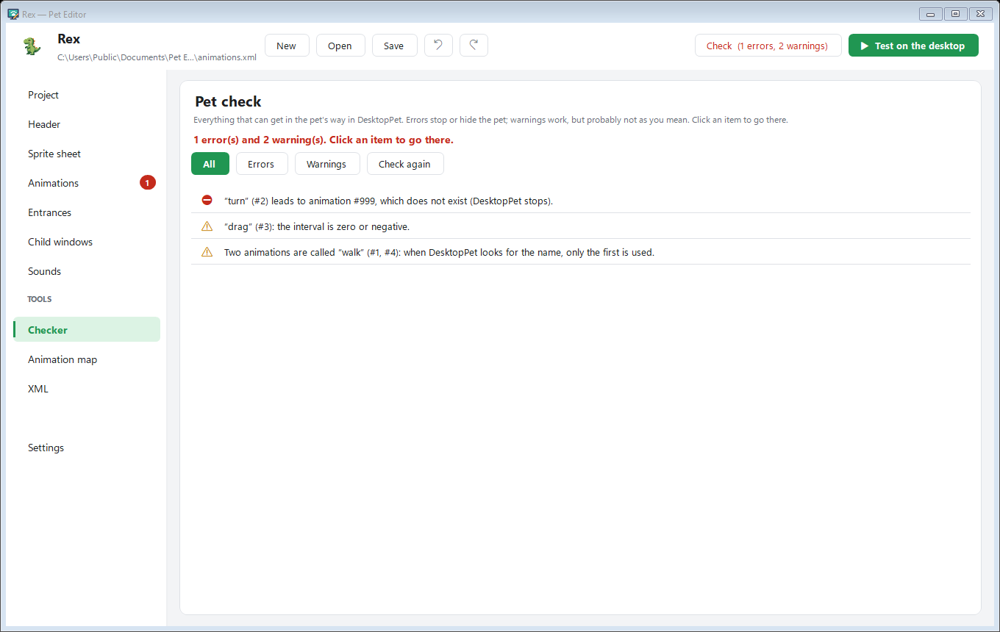
      <h4>✅ A checker that never sleeps</h4>
      Missing animations, frames out of the sheet, a pet that walks off the screen, formulas that do not work… found
      a moment after each change, with a number in the side bar and a click to go there.
    </td>
    <td valign="top">
      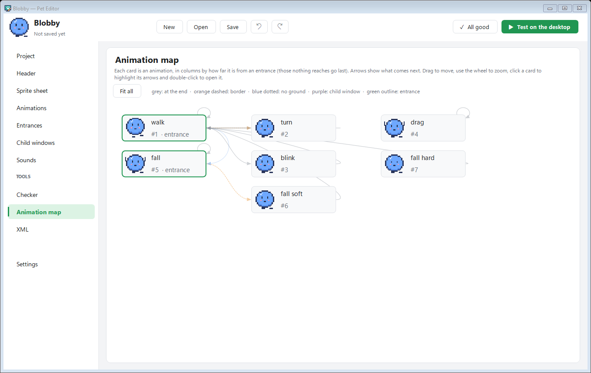
      <h4>🗺️ The animation map</h4>
      Every animation as a card, with arrows to what comes next: see at a glance how the pet moves from one animation
      to another — and what nothing reaches.
    </td>
  </tr>
  <tr>
    <td valign="top">
      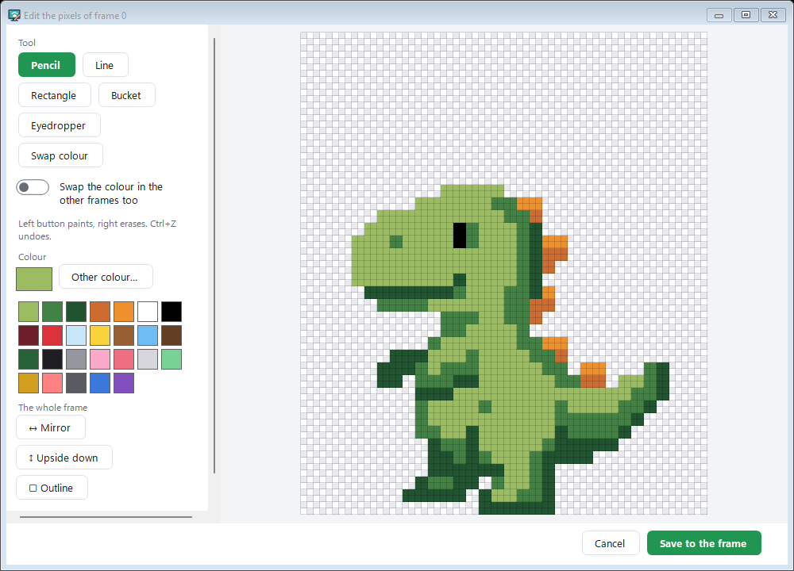
      <h4>🎨 Pixel editor and skins</h4>
      Pencil, line, rectangle, bucket, eyedropper, colour swap in every frame, outline, mirror. Make a skin: the same
      pet in other colours.
    </td>
    <td valign="top">
      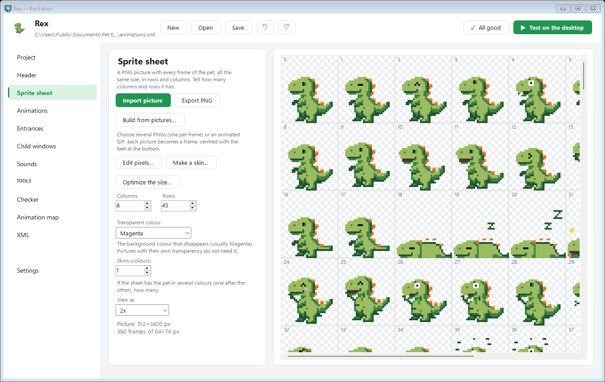
      <h4>🖼️ Sprite sheet</h4>
      Import a PNG or build the sheet from separate pictures or a GIF. Columns, rows, transparent colour, skins — and an
      optimizer that removes unused frames and compresses the picture.
    </td>
  </tr>
</table>

**And also:** entrances, child windows (a ball, a bathtub, a ship that appears with an animation), MP3 sounds, the XML
as it will be saved, **Test on the desktop** (`F5`) in a real DesktopPet updated with every change, **Export as .zip**
ready to send, undo and redo for everything, a copy of your work every minute, drop files on the window, light and dark
themes, and a size that follows the zoom of Windows.

<p align="center">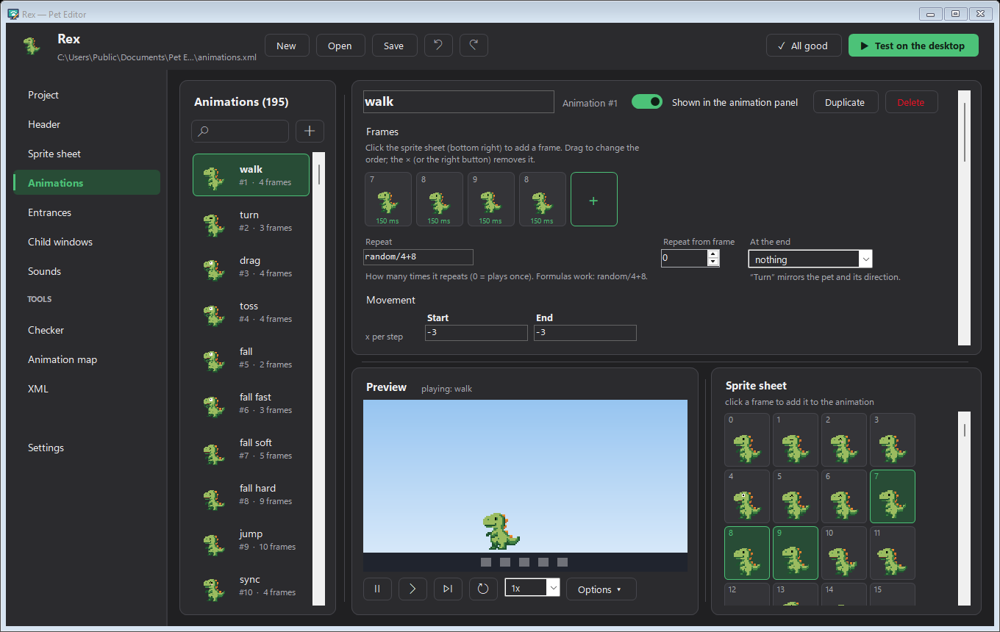</p>

## ⬇️ Install

1. Install the [.NET 10 Desktop Runtime](https://dotnet.microsoft.com/download/dotnet/10.0) (Windows 10 or 11, 64-bit).
2. Download [`PetEditor.exe`](https://github.com/lfeliipeadv-stack/desktop-pet-editor/releases/latest/download/PetEditor.exe) and run it — one file, nothing to install.
3. Optional: [DesktopPet](https://github.com/lfeliipeadv-stack/meu-pet) 2.8.3 or newer for **Test on the desktop**.

The settings are kept in `%AppData%\DesktopPet\PetEditor.json`. Each release has `SHA256SUMS` to check the download.

## 📖 Documentation

The **[Wiki](https://github.com/lfeliipeadv-stack/desktop-pet-editor/wiki)** has a page, with pictures, for every part
of the program — also **[in Portuguese](https://github.com/lfeliipeadv-stack/desktop-pet-editor/wiki/Inicio)**.

| Start | The pages | Reference |
| --- | --- | --- |
| [Installation](https://github.com/lfeliipeadv-stack/desktop-pet-editor/wiki/Installation) | [Animations](https://github.com/lfeliipeadv-stack/desktop-pet-editor/wiki/Animations) | [Formulas](https://github.com/lfeliipeadv-stack/desktop-pet-editor/wiki/Formulas) |
| [Getting started](https://github.com/lfeliipeadv-stack/desktop-pet-editor/wiki/Getting-started) | [Sprite sheet](https://github.com/lfeliipeadv-stack/desktop-pet-editor/wiki/Sprite-sheet) | [Keyboard and mouse](https://github.com/lfeliipeadv-stack/desktop-pet-editor/wiki/Keyboard-and-mouse) |
| [The window](https://github.com/lfeliipeadv-stack/desktop-pet-editor/wiki/The-window) | [Checker](https://github.com/lfeliipeadv-stack/desktop-pet-editor/wiki/Checker) | [The pet format](https://github.com/lfeliipeadv-stack/desktop-pet-editor/wiki/Pet-format) |
| [Test on the desktop](https://github.com/lfeliipeadv-stack/desktop-pet-editor/wiki/Test-on-the-desktop) | [Sharing a pet](https://github.com/lfeliipeadv-stack/desktop-pet-editor/wiki/Sharing) | [FAQ](https://github.com/lfeliipeadv-stack/desktop-pet-editor/wiki/FAQ) |

The same pages are also in the [`wiki`](wiki/Home.md) folder of this repository.

## 🛠️ Build

```bash
dotnet build src/PetEditor.csproj -c Release
dotnet publish src/PetEditor.csproj -c Release -o out    # a single PetEditor.exe
```

C# and Windows Forms on .NET 10. The files in [`src/Shared`](src/Shared) come from DesktopPet (the XML model, the theme
and the MP3 player), so the editor reads and writes pets exactly as the app does. Tests, the options of
`PetEditor.exe` and how the pictures of the wiki are made: [For developers](https://github.com/lfeliipeadv-stack/desktop-pet-editor/wiki/For-developers).

Found a problem or have an idea? [Open an issue](https://github.com/lfeliipeadv-stack/desktop-pet-editor/issues).

## 🙏 Credits

This editor stands on the work of **[Adriano Petrucci](https://github.com/Adrianotiger)**:

- **[desktopPet](https://github.com/Adrianotiger/desktopPet)** — the Windows version of the classic eSheep, where the
  pet format (`animations.xml`) was born. DesktopPet, the app these pets are made for, is a fork of it.
- **[desktopPet-Editor](https://github.com/Adrianotiger/desktopPet-Editor)** — his web editor for these pets, which
  inspired this one and the online editor.
- **[`src/Shared/AnimationXML.cs`](src/Shared/AnimationXML.cs)** — the model of the pet format, from desktopPet (by
  Adriano Petrucci and its contributors, MIT license), used here as it is.

Thank you, Adriano, for the sheep and everything that came after it. 🐑

The pet in the pictures is Rex, from the [DesktopPet gallery](https://github.com/lfeliipeadv-stack/meu-pet/tree/master/Pets).

## 📄 License

MIT — see [LICENSE](LICENSE).
