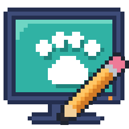
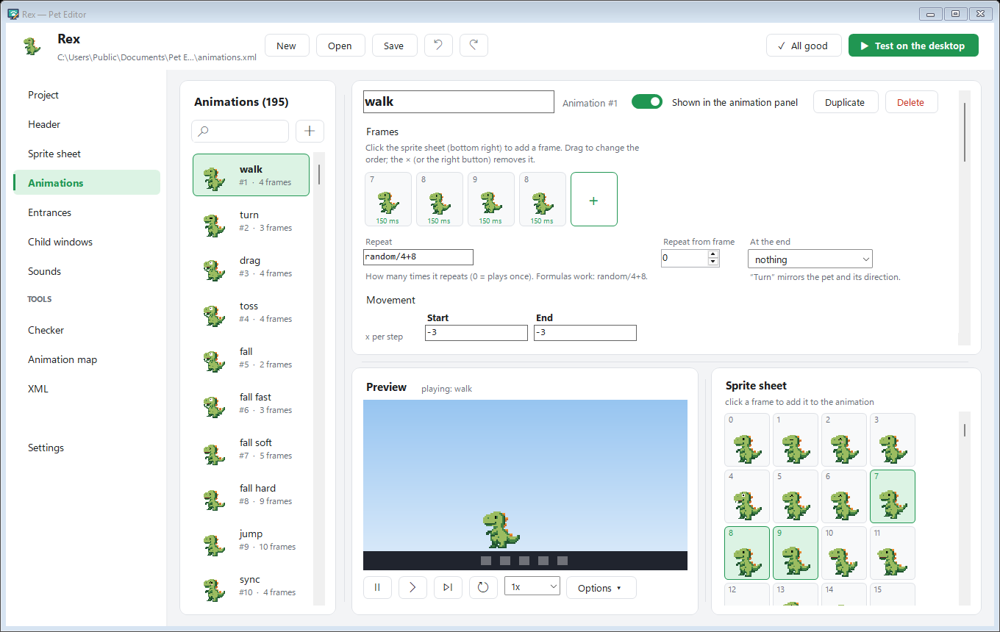
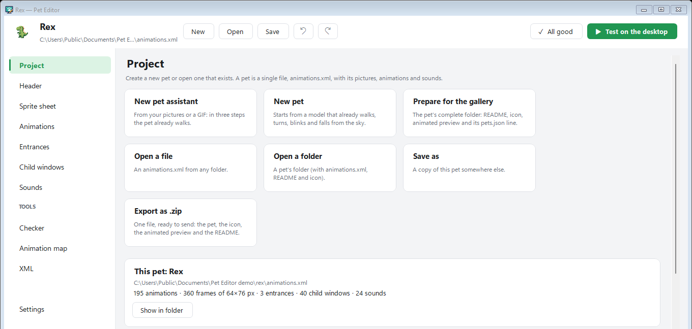
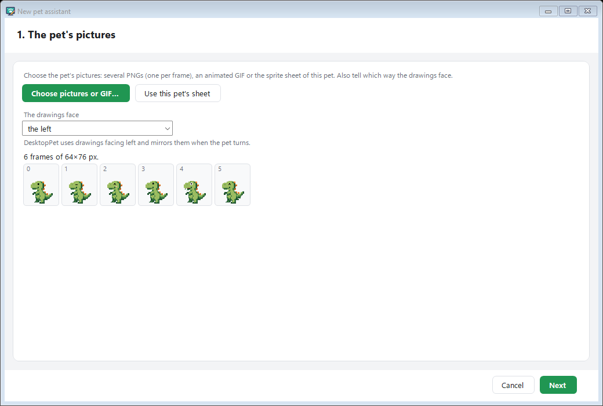
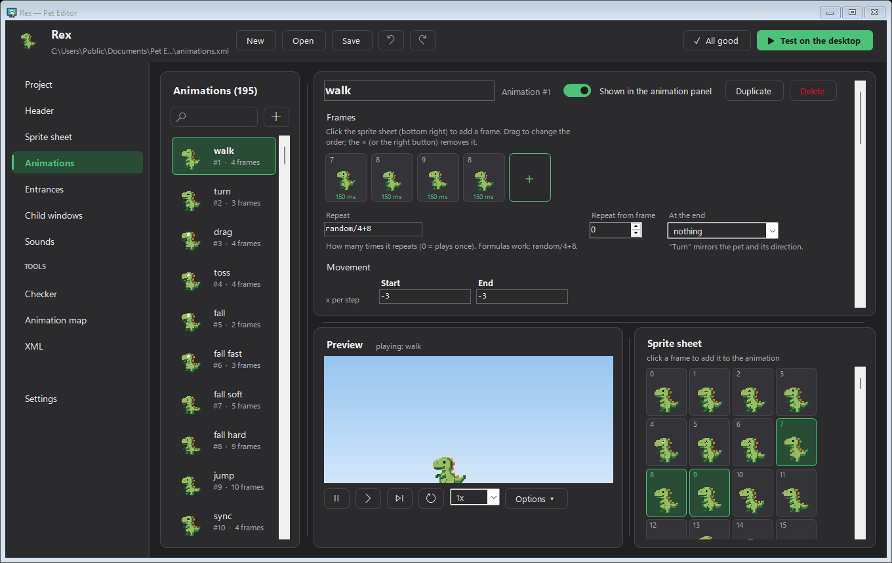

<p align="center">
  
</p>

<h1 align="center">Desktop Pet Editor</h1>

<p align="center">
  A Windows program to create and edit desktop pets — the little animated characters that walk on your windows,
  fall on the taskbar and can be dragged with the mouse.
</p>

<p align="center">
  <a href="https://github.com/lfeliipeadv-stack/desktop-pet-editor/releases/latest/download/PetEditor.exe"><b>⬇️ Download PetEditor.exe</b></a>
  &nbsp;·&nbsp;
  <a href="https://github.com/lfeliipeadv-stack/desktop-pet-editor/releases">All releases</a>
  &nbsp;·&nbsp;
  <a href="https://github.com/lfeliipeadv-stack/meu-pet">DesktopPet, the app that runs the pets</a>
</p>



A pet is a single `animations.xml` file with its sprite sheet, animations, entrances, child windows and sounds inside.
The editor opens it, shows every part on its own page and plays the pet in a live preview while you change it — no XML
by hand. It is made for [DesktopPet](https://github.com/lfeliipeadv-stack/meu-pet) and writes the same `animations.xml`
format it reads.

## Features

**Start a pet**
- **New pet assistant**: choose your pictures (several PNGs or an animated GIF), tell which way they face, pick the
  frames for walking, turning, falling and being dragged — in three steps the pet already walks.
- **New pet** from a model that already walks, turns, blinks and falls from the sky.
- Open any `animations.xml`, a pet folder, or one of the pets downloaded in DesktopPet to see how it was made.
- Drag pictures, a GIF or an `animations.xml` onto the window.

**Edit it**
- **Sprite sheet**: import a PNG, build one from separate pictures, set columns, rows, transparent colour and skins.
- **Animations**: frames by clicking the sheet (drag to reorder), repeat count, movement per step, opacity and speed
  (formulas such as `random/4+8` or `screenW+10` work), and what comes next — at the end, on a border, without ground.
- **Ready-made animations**: walk, turn, run, jump, climb the side, sit, sleep… made from your frames.
- **Copy animations from another pet**, with the frames, the animations that follow them and their child windows.
- **Entrances**, **child windows** (a second picture that appears with an animation) and **MP3 sounds**.
- **Pixel editor**: pencil, line, rectangle, bucket, eyedropper, colour swap (in one frame or all of them), outline,
  mirror and move. **Skins**: the same pet in other colours.
- Undo and redo for everything, and a copy of your work every minute (brought back if the editor closes unexpectedly).

**Check it**
- **Live preview** that plays the pet like DesktopPet does: borders, gravity, flips, child windows, the mouse to drag
  and throw it, a test window to walk on, frame-by-frame stepping and the frame before shown underneath.
- **Checker**: animations nothing reaches, missing frames, wrong numbers… each problem is one click from its place,
  and the side bar and the list of animations show how many there are.
- **Animation map**: every animation as a card with arrows to what comes next.
- **XML** page with the file as it will be saved (editable).
- **Test on the desktop**: runs the pet in DesktopPet and reloads it every time you save.

**Share it**
- **Export as .zip**: the pet, its icon, an animated preview and a README, ready to send.
- **Prepare for the gallery**: the complete folder for a pet gallery, with its `pets.json` line.
- **Optimize the size**: removes unused frames and saves the sheet with a palette when it can.

**Comfort**
- English and Portuguese, light and dark themes, accent colours.
- Follows the zoom of Windows, or a size of its own (80% to 150%) in Settings.
- Keyboard: `Ctrl+N/O/S`, `Ctrl+Z/Y`, `F5` tests on the desktop; in the preview `Space` pauses, `→` steps, `R` restarts.
- A short tour the first time it opens.

## Screenshots

<table>
  <tr>
    <td width="50%"><br><sub>Project: start, open, save and share</sub></td>
    <td width="50%"><br><sub>Sprite sheet: every frame of the pet</sub></td>
  </tr>
  <tr>
    <td><br><sub>New pet assistant: from your pictures or a GIF</sub></td>
    <td><br><sub>Ready-made animations made from your frames</sub></td>
  </tr>
  <tr>
    <td><br><sub>Pixel editor: small retouches without leaving the editor</sub></td>
    <td><br><sub>The dark theme</sub></td>
  </tr>
</table>

## Install

1. Install the [.NET 10 Desktop Runtime](https://dotnet.microsoft.com/download/dotnet/10.0) (Windows 10 or 11, 64-bit).
2. Download [`PetEditor.exe`](https://github.com/lfeliipeadv-stack/desktop-pet-editor/releases/latest/download/PetEditor.exe) and run it. Nothing else to install.

The settings are kept in `%AppData%\DesktopPet\PetEditor.json`.

**Test on the desktop** needs [DesktopPet](https://github.com/lfeliipeadv-stack/meu-pet) 2.8.3 or newer (it runs
`DesktopPet.exe --test-pet=<file>`, a copy of the app that shows only that pet and saves nothing). Everything else
works without it.

## Build

```bash
dotnet build src/PetEditor.csproj -c Release
dotnet publish src/PetEditor.csproj -c Release -o out    # a single PetEditor.exe
```

The files in [`src/Shared`](src/Shared) come from DesktopPet (the XML model, the theme and the MP3 player), so the
editor reads and writes pets exactly as the app does.

Developer options of `PetEditor.exe`:

| Option | What it does |
| --- | --- |
| `--devtests=<Pets folder>` | Runs the editor's tests (assistant, copy between pets, GIF, optimizer, .zip); the exit code is the number of failures. Uses the `pingo` pet of the [DesktopPet gallery](https://github.com/lfeliipeadv-stack/meu-pet/tree/master/Pets). |
| `--roundtrip=<Pets folder>` | Reads and writes again every pet of the folder; exits with 0 when nothing changed. |
| `<pet> --snap=<folder>` | A picture of every page and window, light and dark, plus `cortes.txt` with any text cut off. `--snapsize=1000x660` sets the window size. |
| `--scale=1.5` / `--lang=en` / `--settings=<file>` | Another zoom, language or settings file for this run only. |

## Credits

Pets use the format of [desktopPet](https://github.com/Adrianotiger/desktopPet) by Adriano Petrucci, the Windows
version of the classic eSheep. The pet in the screenshots is Rex, from the DesktopPet gallery.

## License

MIT — see [LICENSE](LICENSE).
