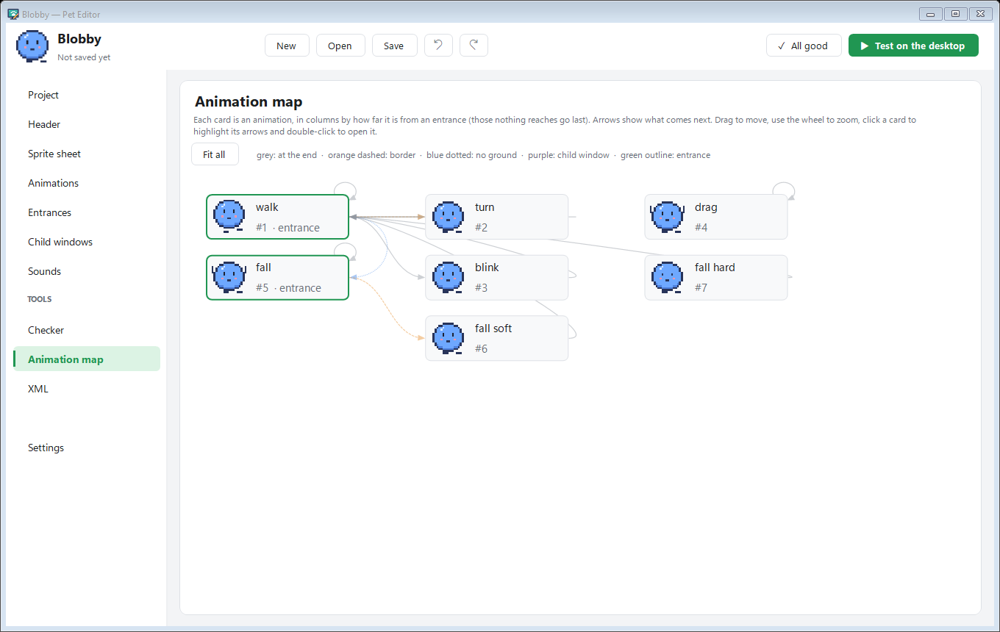
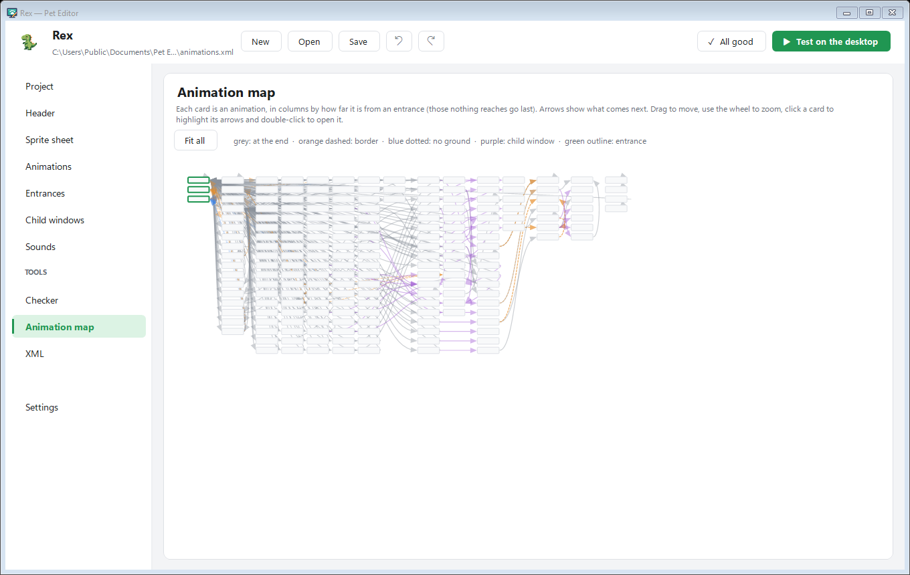

# Animation map

[← Wiki home](Home.md) · [Português](pt-BR/Mapa-das-animacoes.md)

Every animation as a card, and arrows to what comes next. It shows at a glance how the pet goes from one animation to
another, and what nothing reaches.

- The cards are in **columns** by how far each animation is from an entrance: the first column is what the
  [entrances](Entrances.md) start with, the next column what those lead to, and so on. Animations nothing reaches go
  last.
- A **green outline** marks an animation an entrance starts with.
- The arrows: **grey** = at the end, **orange dashed** = on a border, **blue dotted** = without ground, **purple** =
  child window.

| Mouse | What it does |
| --- | --- |
| Drag | Moves the map |
| Wheel | Zooms in and out |
| Click a card | Highlights its arrows |
| Double-click a card | Opens the animation on the [Animations](Animations.md) page |
| **Fit all** | Shows the whole map |

A big pet (hundreds of animations) makes a big map: zoom in on the part you are working on.

