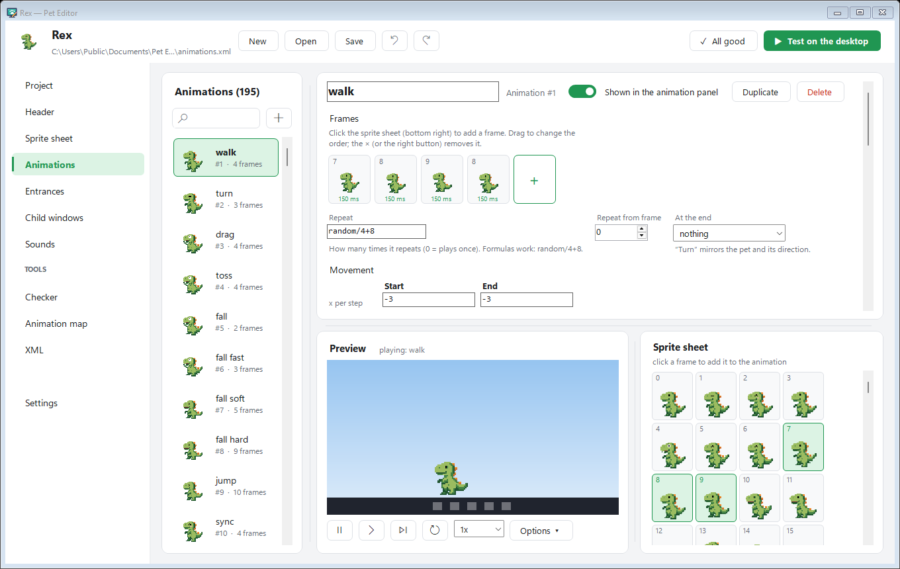
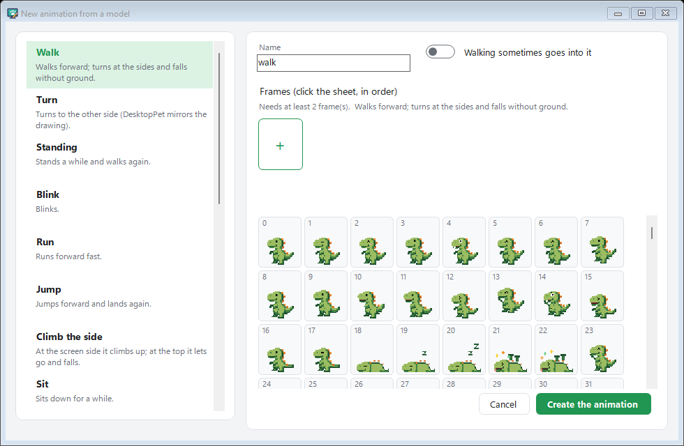
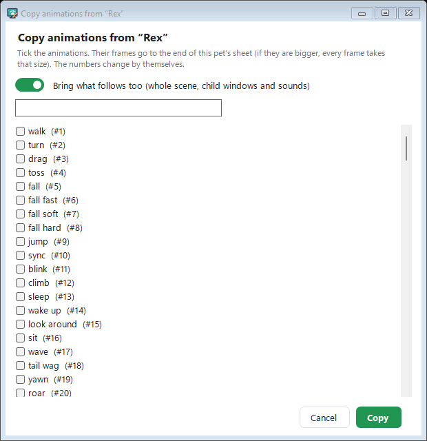
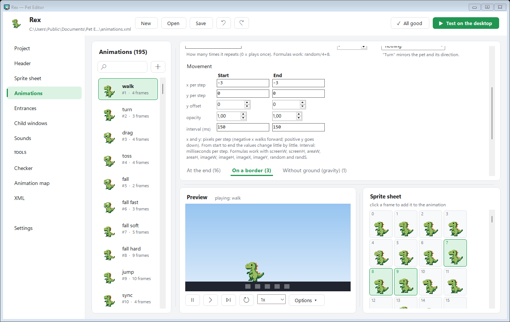

# Animations

[← Wiki home](Home.md) · [Português](pt-BR/Animacoes.md)

The heart of the pet. Each animation is a list of frames, a movement, and what comes after it. DesktopPet plays one
animation at a time and then chooses the next one.

The page has four parts, with dividers you can drag (their places are remembered):

1. the **list** of animations (left);
2. the **editor** of the chosen one (top right);
3. the [preview](Preview.md) (bottom);
4. the **sprite sheet**, to click frames into the animation (bottom right).

## The list

- Each line shows the first frame, the name, the number (`#1`) and how many frames it has. *not in the panel* means it
  is hidden from DesktopPet's animation panel.
- The **search box** finds by part of the name or by the number. `Esc` clears it.
- A ⛔ or ⚠ at the right means the [Checker](Checker.md) found a problem in that animation; the mouse over the line
  shows the whole name and the problems.
- `Delete` deletes the chosen animation (it asks first).

## New animations

The **+** button above the list opens a menu:

| Choice | What it makes |
| --- | --- |
| **Blank** | An empty animation, to fill by hand. |
| **From a ready-made model…** | A behaviour already set up (walk, turn, run, jump, climb, sit, sleep, dance…) made with your frames. |
| **Copy from another pet…** | Animations of another `animations.xml`, with their frames. |

### From a ready-made model

Choose a model on the left, give it a name and click its frames on the sheet, in order (the window says how many it
needs). **Walking sometimes goes into it** adds it to the animations the walk draws now and then (for idle tricks such
as blink, sit or dance). **Create the animation** adds it with its movement and its next animations already set.

| Model | What it does |
| --- | --- |
| Walk | Walks forward; turns at the sides and falls without ground. |
| Turn | Turns to the other side (DesktopPet mirrors the drawing). |
| Standing | Stands a while and walks again. |
| Blink | Blinks. |
| Run | Runs forward fast. |
| Jump | Jumps forward and lands again. |
| Climb the side | At the screen side it climbs up; at the top it lets go and falls. |
| Sit | Sits down for a while. |
| Sleep | Sleeps a good while (DesktopPet also uses it when you tell it to sleep). |
| Happy | Shows it is happy (DesktopPet uses it in reactions). |
| Dance | Dances in place. |
| Talk | Moves its mouth: DesktopPet uses it while a bubble is shown. |
| Fall | Falls faster and faster to the ground or a window (used when the pet is let go). |
| Land | Reaches the ground after falling or being thrown. |
| Picked up | While the mouse holds the pet. |
| Leave | Fades out when the pet leaves. |

### Copy from another pet

Choose the other pet's `animations.xml`, then tick the animations. Their frames go to the end of this pet's sheet (if
they are bigger, every frame takes that size) and the numbers change by themselves. **Bring what follows too** also
copies the animations they lead to (the whole scene), their child windows and sounds. Animations both pets have with
the same name are linked instead of copied twice.

## The editor of an animation

| Part | What it is |
| --- | --- |
| **Name** | The name DesktopPet uses. Some names have a special meaning (below). |
| **Animation #n** | Its number, used by the next lists, entrances, child windows and sounds. |
| **Shown in the animation panel** | Whether it appears in the list where DesktopPet's user picks an animation by hand. |
| **Duplicate** | A copy with a new number. |
| **Delete** | Removes it. If something uses it (another animation, an entrance, a child window, a sound), the editor says what, and it also leaves those lists. |

### Frames

Click frames on the sprite sheet (bottom right) to add them. In the strip:

- drag a frame to change the order; its **×** (or the right button → *Remove*) takes it out;
- under each frame is how long it stays on the screen, in milliseconds;
- the **+** tile reminds you to click the sheet;
- the **right button** on a frame opens: *Hold longer (2× / 3×)* (repeats it in place), *Repeat at the end*,
  *Edit the pixels of this frame…*, *Reverse the order* and *Remove from the animation*.

### Repeat

| Field | What it is |
| --- | --- |
| **Repeat** | How many times the frames repeat (0 = plays once). A [formula](Formulas.md) works: `random/4+8` repeats 8 to 32 times. |
| **Repeat from frame** | Where the repetition starts again (0 = from the first frame). Use it for an animation with a beginning that plays once and a middle that loops. |
| **At the end** | *nothing*, or *turn (flip)*: mirrors the pet and its direction when the animation ends. |

### Movement

One column for the **start** and one for the **end**; the values change little by little from one to the other over
all the steps of the animation.

| Line | What it is |
| --- | --- |
| **x per step** | Pixels sideways per step. Negative walks **forward** (the drawing faces left). |
| **y per step** | Pixels up or down per step. Positive goes **down**. |
| **y offset** | Moves the drawing up or down without moving the pet (for frames drawn higher or lower). |
| **opacity** | 0 (invisible) to 1 (solid). From 1 to 0 makes a fade out. |
| **interval (ms)** | Milliseconds per step: smaller is faster. A [formula](Formulas.md) works. |

### What comes next

Three tabs, with the number of choices in each:

| Tab | When it is used |
| --- | --- |
| **At the end** | When the animation ends. |
| **On a border** | When the pet hits a border while moving: a side of the screen, the taskbar, the top of a window… |
| **Without ground (gravity)** | When there is nothing under the pet (it walked off a window). |

Each line is one choice: the animation, **where** it counts, its **chance** and a bar with its share. DesktopPet draws
one by the chances. *add a next one* adds a line, **×** removes it.

| Where | The choice counts… |
| --- | --- |
| anywhere | always |
| only on the taskbar | when the pet is on the taskbar |
| only on a window | when the pet is on top of a window |
| only top/bottom border | at the top or bottom border |
| only screen sides | at the left or right side of the screen |
| side of a window | at the side of a window |
| side of another pet | next to another pet |

With no choice at the end, the pet appears again somewhere else (from an [entrance](Entrances.md)).

## Names with a special meaning

DesktopPet looks for these names; the editor explains them under the name when you use one.

| Name | When DesktopPet plays it |
| --- | --- |
| `drag` | while the pet is held with the mouse |
| `fall` | when let go, or without ground |
| `toss` | while the pet flies after being thrown |
| `fall soft` | when a thrown pet lands slowly |
| `fall hard` | when a thrown pet lands hard |
| `kill` | when the pet goes away (closing the app or changing pet) |
| `sync` | by every pet at the same time |

The [Checker](Checker.md) warns when one of them is missing (DesktopPet then uses a plain one).
