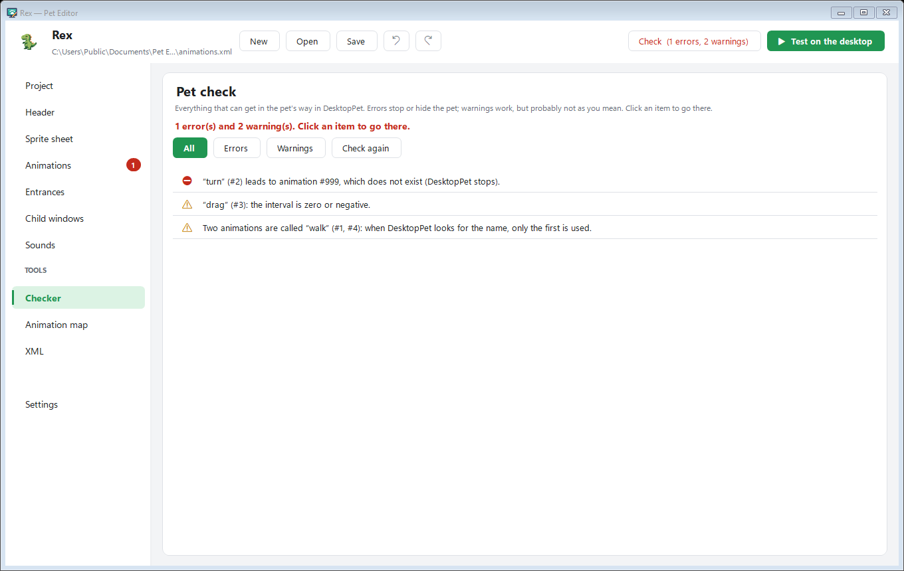
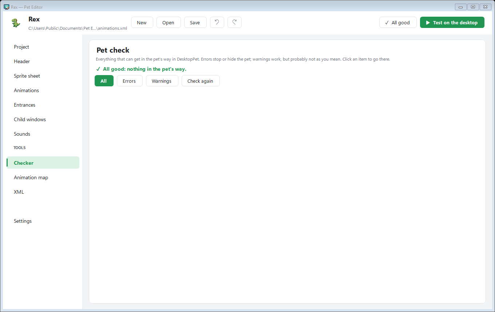

# Checker

[← Wiki home](Home.md) · [Português](pt-BR/Verificador.md)

Everything that can get in the pet's way in DesktopPet. **Errors** stop or hide the pet; **warnings** work, but
probably not as you mean.

- The check runs by itself a moment after each change. The button in the top bar shows the result
  (**All good** or **Check (n errors, n warnings)**), the side bar shows a number next to each page with problems, and
  the list of animations marks the animations with ⛔ / ⚠ ([The window](The-window.md#the-side-bar)).
- **All / Errors / Warnings** filter the list; **Check again** runs it now.
- **Click an item** to go to its place (the animation opens on the Animations page).
- When saving or testing a pet with errors, the editor asks first.

## Errors

| Message | What to do |
| --- | --- |
| The sprite sheet is missing. | Import one on the [Sprite sheet](Sprite-sheet.md) page. |
| There is no entrance: the pet does not appear. | Add one on [Entrances](Entrances.md). |
| Every entrance has chance zero: the pet does not appear. | Give a chance to at least one entrance. |
| There are no animations. | Make one ([Animations](Animations.md)). |
| Two animations with the number #n. / Two entrances with the number #n. | Each needs its own number (fix it in the [XML](XML.md)). |
| Entrance #n starts with animation #m, which does not exist. | Choose an existing animation. |
| *Animation* leads to animation #n, which does not exist (DesktopPet stops). | Fix or remove that line of *What comes next*. |
| *Animation* has no frames. | Click frames on the sheet. |
| *Animation* uses frame *n*, but the sheet only goes up to *m*. | Remove the frame or enlarge the sheet. |
| *Animation*: "repeat from frame" is past the last frame. | Lower it. |
| A child window is made by / plays animation #n, which does not exist. | Fix the [child window](Child-windows.md). |
| A sound plays with animation #n, which does not exist. | Fix the [sound](Sounds.md). |
| *Place*: the formula "…" does not work. | Fix the [formula](Formulas.md) (the message says why). |

## Warnings

| Message | What it means |
| --- | --- |
| The pet has no name. | Fill in the [Header](Header.md). |
| The picture does not split into *c* columns × *r* rows. | Fix columns and rows on the [Sprite sheet](Sprite-sheet.md) page, or the frames come out cut. |
| *Animation*: the interval is zero or negative. | Use milliseconds above 0. |
| *Animation*: every chance of "…" is zero, none is chosen. | Give a chance to at least one next animation. |
| *Animation* has no next one: at the end the pet appears somewhere else. | Add what comes next, if that is not what you want. |
| *Animation* moves but says nothing for a border: the pet leaves the screen. | Add a choice in *On a border*. |
| *Animation* is never played (no animation or entrance leads to it). | Lead to it from another animation, or delete it. |
| There is no "drag" (or "fall", "kill"…) animation. | DesktopPet uses a plain one ([special names](Animations.md#names-with-a-special-meaning)). |
| Two animations are called "…": only the first is used. | Rename one. |
| The child window that starts with "…" never ends. | It stays until the pet goes; give its animations an end. |
| The sound of "…" is *n* KB. | It makes the pet heavy to download ([Sounds](Sounds.md)). |
| Frames of *w*×*h* px are too big for a desktop pet. | Make the frames smaller. |
