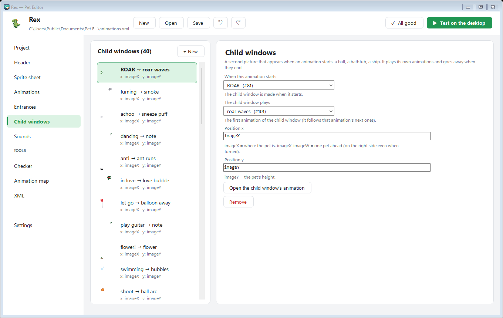

# Child windows

[← Wiki home](Home.md) · [Português](pt-BR/Janelas-filhas.md)

A child window is a second picture that appears when an animation starts: a ball the pet kicks, a bathtub, a ship, a
bubble of smoke. It plays its own animations (made of frames of the same sprite sheet) and goes away when they end.

The list shows each child window as *animation that makes it → animation it plays*. **+ New** adds one.

| Field | What it is |
| --- | --- |
| **When this animation starts** | The animation of the pet that makes the child window. |
| **The child window plays** | Its first animation. It then follows that animation's next ones, like the pet. |
| **Position x** | `imageX` = where the pet is. `imageX-imageW` = one pet ahead (on the right side even when the pet is turned). |
| **Position y** | `imageY` = the pet's height on the screen. |
| **Open the child window's animation** | Goes to that animation on the [Animations](Animations.md) page. |

## How to make one

1. Draw the frames of the object on the [sprite sheet](Sprite-sheet.md).
2. Make an animation with those frames (for example *ball rolls*), with its movement.
3. End it with no next animation, so the child window goes away — or give it next ones for a longer scene.
4. Here, choose the pet animation that throws the ball and the *ball rolls* animation.

A child window whose animations never end stays on the screen until the pet goes; the [Checker](Checker.md) warns
about it.
