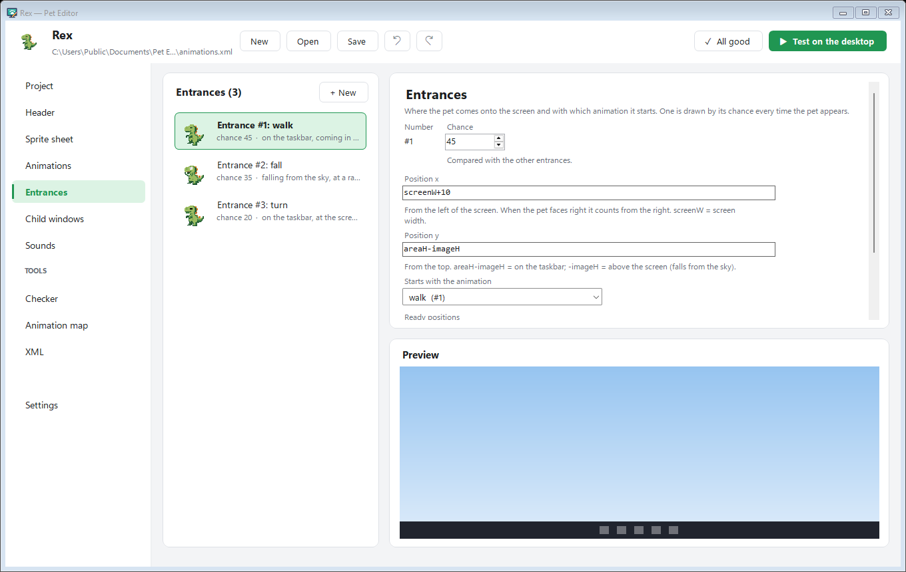

# Entrances

[← Wiki home](Home.md) · [Português](pt-BR/Entradas.md)

Where the pet comes onto the screen and with which animation it starts. Every time the pet appears, DesktopPet draws
one entrance by its chance.

The list on the left shows each entrance with its chance and where it is, in words (*on the taskbar*, *falling from
the sky*, *coming in from the side*…). **+ New** adds one; `Delete` removes the chosen one.

| Field | What it is |
| --- | --- |
| **Number** | The entrance's number. |
| **Chance** | Compared with the other entrances: 40, 30 and 30 means 40%, 30% and 30%. |
| **Position x** | From the left of the screen. When the pet faces right it counts from the right. `screenW` = the screen width. |
| **Position y** | From the top. `areaH-imageH` = on the taskbar; `-imageH` = above the screen (falls from the sky). |
| **Starts with the animation** | The first animation played. |

**Ready positions** fill x and y with the usual places: *On the taskbar*, *Coming from the side*, *Falling from the
sky*. **Try this entrance** shows it in the preview on the right.

The positions are [formulas](Formulas.md). Some useful ones:

| Place | x | y |
| --- | --- | --- |
| On the taskbar, coming from the right side | `screenW` | `areaH-imageH` |
| Falling from the sky at a random place | `random*(screenW-imageW-50)/100+25` | `-imageH` |
| On the taskbar at a random place | `random*(screenW-imageW-50)/100+25` | `areaH-imageH` |

A pet with no entrance does not appear; the [Checker](Checker.md) says so.
