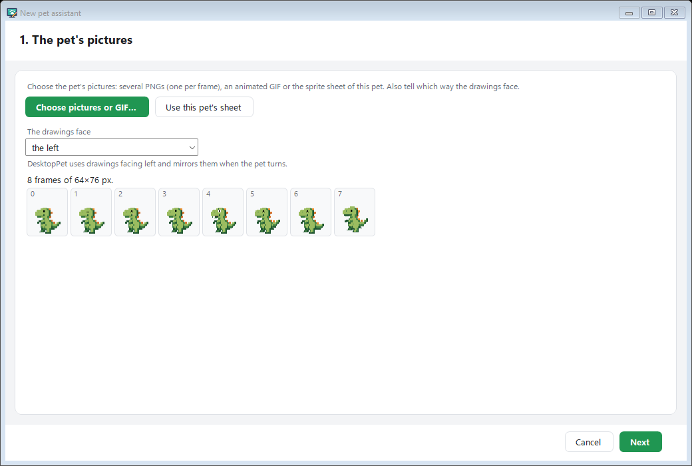
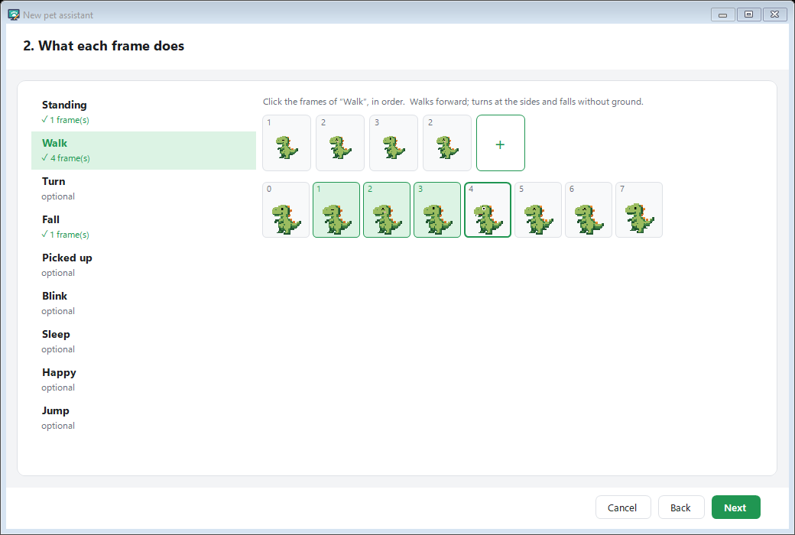
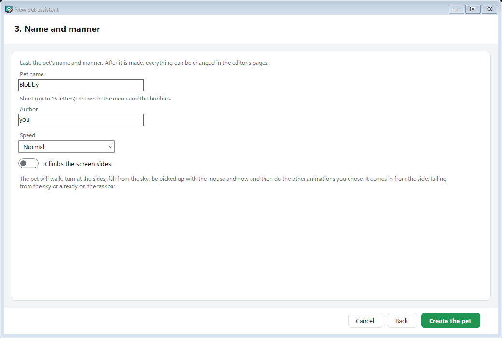

# Getting started: your first pet

[← Wiki home](Home.md) · [Português](pt-BR/Primeiros-passos.md)

This page makes a pet from your own pictures in a few minutes, with the **New pet assistant**.

## What you need

The drawings of the pet, one of these:

- several PNG pictures, one per frame (for example `walk_1.png`, `walk_2.png`…). Pictures numbered in their names keep
  the number order (`frame_2` comes before `frame_10`);
- an animated GIF;
- or the sprite sheet of the pet that is already open.

Small pictures work best (desktop pets are usually 32 to 128 px tall). They can have their own transparency or a
**magenta** background (`#FF00FF`), which disappears.

## 1. The pet's pictures

Open **Project → New pet assistant**, or **New** in the top bar → *New pet assistant*, or drop the pictures on the
window.

- **Choose pictures or GIF…** loads the pictures; each one becomes a frame, centred with the feet at the bottom. If
  they have different sizes, every frame takes the size of the biggest one.
- **Use this pet's sheet** takes the frames of the pet that is open.
- **The drawings face**: DesktopPet expects drawings facing **left** and mirrors them when the pet turns. If yours face
  right, choose *the right* and they are mirrored for you.

Click **Next**.

## 2. What each frame does

On the left are the roles. Choose one, then click its frames on the sheet, in order. A frame can be used more than
once (`1, 2, 3, 2` makes a smooth walk). The strip on top shows the frames of the chosen role: drag a frame to change
the order, its × removes it.

| Role | Needed | What DesktopPet does with it |
| --- | --- | --- |
| Standing | at least 1 frame | stands a while and walks again |
| Walk | at least 2 frames | walks forward, turns at the sides, falls without ground |
| Turn | optional | plays when it turns around |
| Fall | optional | falls faster and faster to the ground or a window |
| Picked up | optional | while the mouse holds the pet |
| Blink, Sleep, Happy, Jump | optional | now and then, while walking |

A role left empty borrows frames: *Picked up* uses the *Fall* frames, *Turn* uses the first *Standing* and *Walk*
frames, and *Fall* uses the *Standing* ones. Blink, Sleep, Happy and Jump are only made when they have frames.

## 3. Name and manner

- **Pet name**: short (up to 16 letters), shown in DesktopPet's menu and in the bubbles.
- **Author**: your name.
- **Speed**: slow, normal or fast walking.
- **Climbs the screen sides**: at a side of the screen the pet climbs up, and at the top it lets go and falls.

Click **Create the pet**. The editor opens the new pet on the [Animations](Animations.md) page. It already walks, turns
at the sides, falls from the sky, can be picked up with the mouse and has three [entrances](Entrances.md): coming in
from the side, falling from the sky and already on the taskbar.

## Next steps

1. Watch it in the [preview](Preview.md) and grab it with the mouse.
2. Press **Save** (`Ctrl+S`) and choose a folder; the file is called `animations.xml`.
3. Press **Test on the desktop** (`F5`) to see it for real ([Test on the desktop](Test-on-the-desktop.md)).
4. Add more animations: the **+** button on the Animations page → *From a ready-made model…*
   ([Animations](Animations.md#new-animations)).
5. When it is ready, [share it](Sharing.md).
