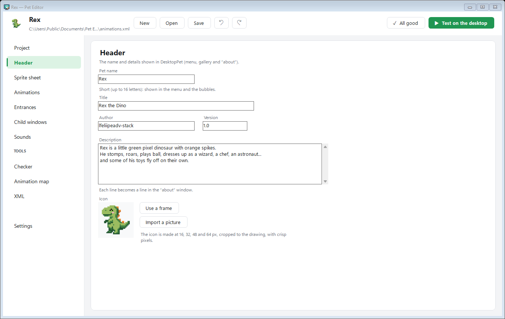
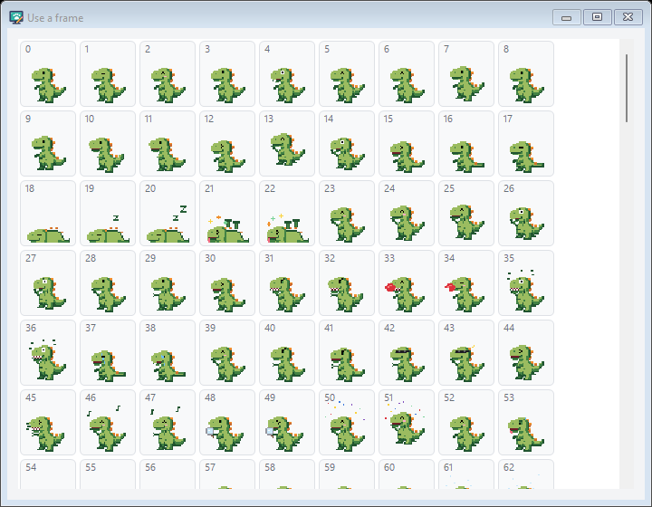

# Header

[← Wiki home](Home.md) · [Português](pt-BR/Cabecalho.md)

The name and details DesktopPet shows: in its menu, in the gallery and in the "about" window.

| Field | What it is |
| --- | --- |
| **Pet name** | Short, up to 16 letters. Shown in DesktopPet's menu and in the bubbles. The [Checker](Checker.md) warns when it is empty. |
| **Title** | The full name (for example *Rex the Dino*). |
| **Author** | Who made the pet. |
| **Version** | Your own numbering (for example `1.0`, `1.1`). Raise it when you change a pet that others already use. |
| **Description** | A few lines about the pet. Each line becomes a line in the "about" window (it is saved with `[br]` between the lines). |
| **Icon** | The picture of the pet in menus and lists. |

## The icon

- **Use a frame** opens the sprite sheet: click the frame that becomes the icon.
- **Import a picture** takes a PNG, ICO, BMP or GIF.

Either way the icon is made at 16, 32, 48 and 64 px, cropped to the drawing (the empty border is cut), with crisp
pixels.

