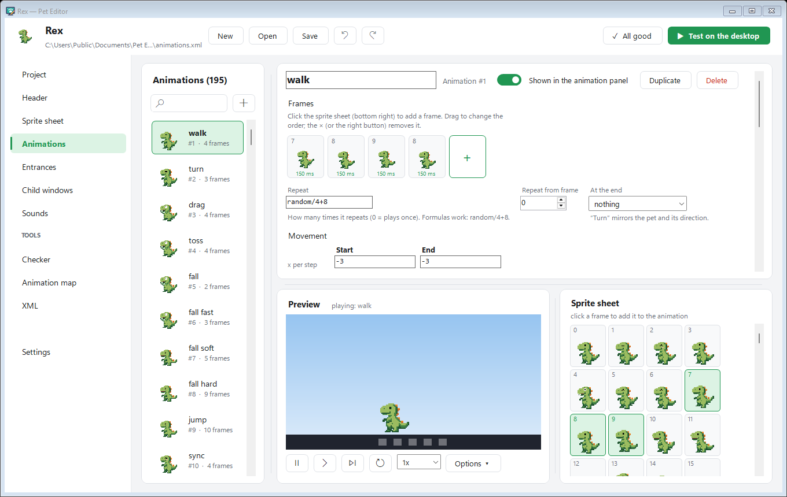

# Desktop Pet Editor — Wiki

**English** · [Português](pt-BR/Home.md)

The **Pet Editor** is a Windows program to create and edit desktop pets: the little animated characters of
[DesktopPet](https://github.com/lfeliipeadv-stack/meu-pet) that walk on your windows, fall on the taskbar and can be
picked up with the mouse. A pet is a single file, `animations.xml`, with its pictures, animations and sounds inside.
The editor shows every part of it on its own page and plays the pet in a live preview while you change it.

## Start here

| Page | What it has |
| --- | --- |
| [Installation](Installation.md) | What you need, where to download, where the settings are kept |
| [Getting started](Getting-started.md) | Your first pet in three steps, with the assistant |
| [The window](The-window.md) | The top bar, the side bar, the numbers of problems, the tour, dropping files |

## The pages of the editor

| Page | What it has |
| --- | --- |
| [Project](Project.md) | New pet, open, recent pets, the pets downloaded in DesktopPet, save as, export |
| [Header](Header.md) | Name, title, author, version, description and icon |
| [Sprite sheet](Sprite-sheet.md) | The picture with every frame: import, build from pictures, grid, transparency, skins |
| [Animations](Animations.md) | Frames, repeat, movement, what comes next, ready-made animations, copy from another pet |
| [Preview](Preview.md) | The live preview: buttons, options, the mouse, the test window |
| [Entrances](Entrances.md) | Where the pet comes onto the screen |
| [Child windows](Child-windows.md) | A second picture that appears with an animation |
| [Sounds](Sounds.md) | MP3 sounds played with the animations |
| [Checker](Checker.md) | Every error and warning the editor finds, and what to do |
| [Animation map](Animation-map.md) | Every animation and the arrows to what comes next |
| [XML](XML.md) | The file as it will be saved, editable by hand |
| [Settings](Settings.md) | Theme, colours, language, size, files, preview and the DesktopPet used for tests |

## Tools

| Page | What it has |
| --- | --- |
| [Pixel editor and skins](Pixel-editor-and-skins.md) | Retouch a frame; the same pet in other colours |
| [Test on the desktop](Test-on-the-desktop.md) | See the pet for real on your screen, updated with every change |
| [Sharing a pet](Sharing.md) | Export as .zip, prepare for a gallery, optimize the size |

## Reference

| Page | What it has |
| --- | --- |
| [Formulas](Formulas.md) | `screenW`, `areaH`, `imageX`, `random`… what each word means |
| [Keyboard and mouse](Keyboard-and-mouse.md) | Every shortcut |
| [The pet format](Pet-format.md) | What is inside `animations.xml` |
| [FAQ](FAQ.md) | Common questions and problems |
| [For developers](For-developers.md) | Build, test, the options of `PetEditor.exe`, the code |

## Credits

This editor stands on the work of [Adriano Petrucci](https://github.com/Adrianotiger): his
[desktopPet](https://github.com/Adrianotiger/desktopPet), the Windows version of the classic eSheep, is where the pet
format was born (DesktopPet is a fork of it), and his web [desktopPet-Editor](https://github.com/Adrianotiger/desktopPet-Editor)
inspired this one. The model of the pet format (`src/Shared/AnimationXML.cs`) comes from desktopPet, MIT license.
