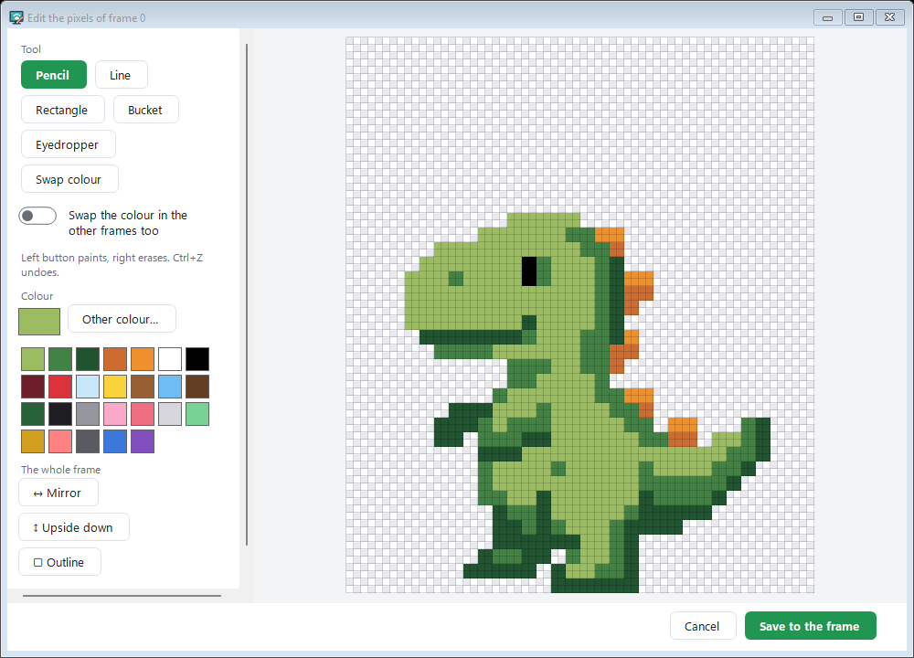
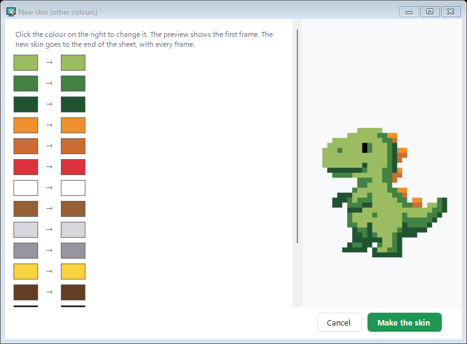

# Pixel editor and skins

[← Wiki home](Home.md) · [Português](pt-BR/Editor-de-pixels-e-skins.md)

## Pixel editor

Small retouches of one frame without leaving the editor. Open it from **Sprite sheet → Edit pixels…** (then click a
frame), or with the right button on a frame of an animation → *Edit the pixels of this frame…*.

The frame is shown big, with its pixel grid. The **left** button paints, the **right** button erases (makes the pixel
transparent). `Ctrl+Z` undoes, up to 60 steps.

| Tool | What it does |
| --- | --- |
| **Pencil** | Paints one pixel at a time (drag to paint more). |
| **Line** | Drag from the first to the last pixel of the line. |
| **Rectangle** | Drag from one corner to the other: the outline of a rectangle. |
| **Bucket** | Paints the area of the same colour. |
| **Eyedropper** | Takes the colour of a pixel. |
| **Swap colour** | Click a colour: it becomes the chosen colour in the whole frame. With **Swap the colour in the other frames too** on, every frame of the pet changes when you save. |

**Colour**: the square is the chosen colour; **Other colour…** opens the Windows colour picker; below are the colours
of the pet, the most used first.

**The whole frame**: **Mirror** (left ↔ right), **Upside down**, **Outline** (a 1-pixel border in the chosen colour
around the drawing) and the arrows **← → ↑ ↓** move the drawing one pixel.

**Save to the frame** writes it into the sprite sheet (one step you can undo in the editor). **Cancel** forgets it.

## Skins

A skin is the same pet in other colours. DesktopPet chooses a skin for each pet on the screen, so two of the same pet
look different. Open it from **Sprite sheet → Make a skin…**.

The main colours of the pet are listed on the left. Click the colour on the right of a line to change it; the preview
shows the first frame. **Make the skin** adds a copy of every frame, in the new colours, at the end of the sheet, and
raises *Skins* on the [Sprite sheet](Sprite-sheet.md) page. Change at least one colour.
