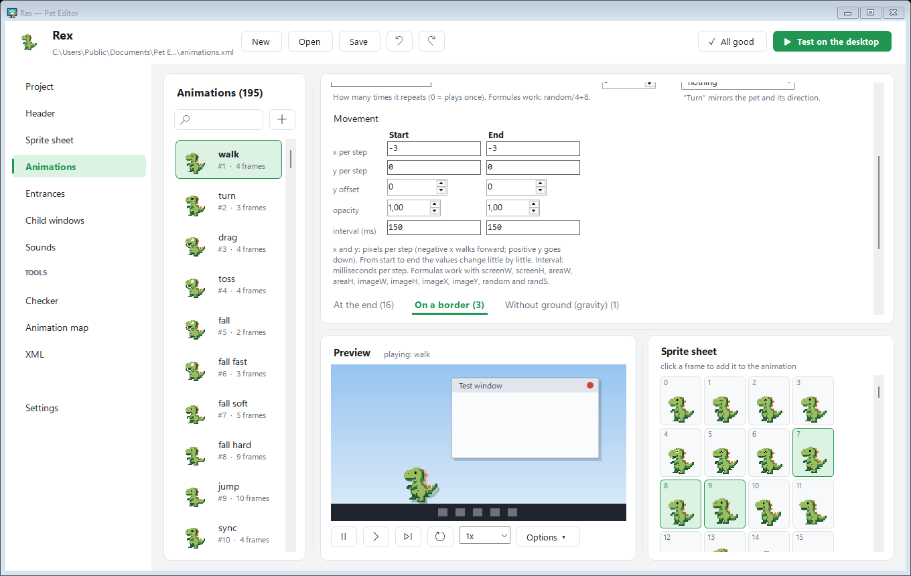

# Preview

[← Wiki home](Home.md) · [Português](pt-BR/Previa.md)

The preview on the [Animations](Animations.md) page plays the pet the way DesktopPet does: it walks, hits the sides,
falls without ground, turns, opens its child windows and goes from one animation to the next by the chances. It
starts with the chosen animation and is updated with every change.

Above it: **playing:** and the name of the animation on stage.

## Buttons

| Button | What it does | Key |
| --- | --- | --- |
| ⏸ / ▶ | Pause / continue | `Space` |
| ❯ | One step (pauses and goes one step at a time) | `→` |
| ⏭ | Next: ends this animation and goes to the next one | |
| ⟳ | From the start of the chosen animation | `R` |
| 0.25x … 2x | Speed | |

The keys work when the cursor is not in a text box.

## Options

| Option | What it does |
| --- | --- |
| **Repeat only this** | Plays the chosen animation again and again instead of going on to the next ones. |
| **Test window** | Puts a window on the stage: the pet lands on it, walks on it and bumps into its sides. Drag it by its title bar. |
| **Frame before** | Shows the frame before, see-through, under the current one — to see how far each frame moves. |

## The mouse

Grab the pet with the mouse: let go slowly to drop it (it falls), or fling it to throw it (it flies, then lands soft or
hard). The `drag`, `toss`, `fall soft` and `fall hard` animations play as in DesktopPet.

## Background and size

In [Settings → Preview](Settings.md#preview): the background (sky, checker or dark), the pet size (1x, 2x, 3x, like the
*scale* option of DesktopPet) and whether the sounds play.

## Differences from DesktopPet

The preview is a stage the size of the panel, with a taskbar at the bottom. On the real desktop the screen is bigger,
there are real windows and other pets — use [Test on the desktop](Test-on-the-desktop.md) for the final look.
