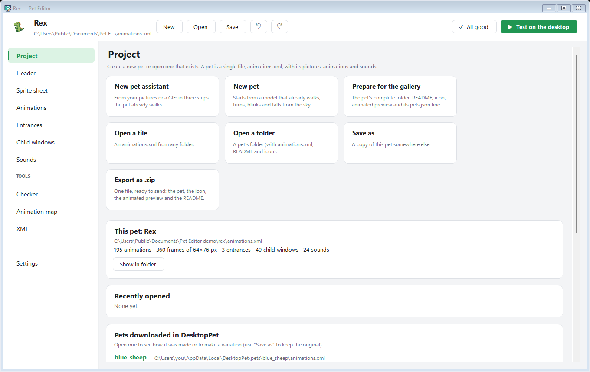
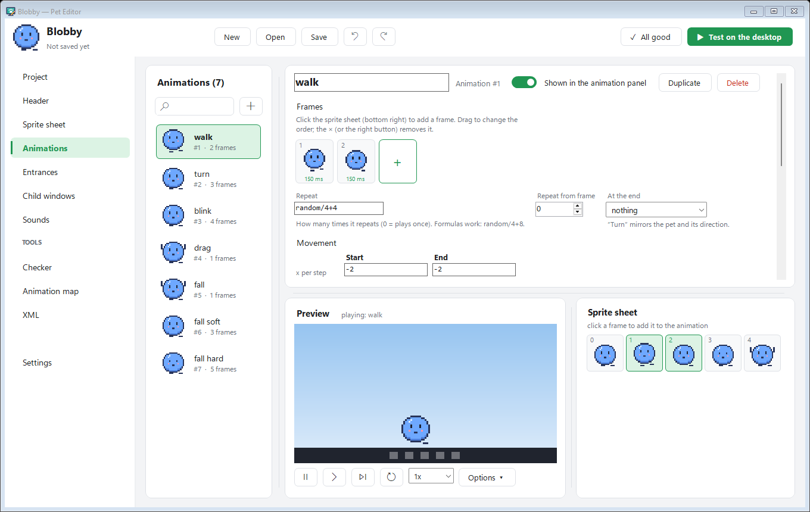

# Project

[← Wiki home](Home.md) · [Português](pt-BR/Projeto.md)

Where you start: a new pet, open one, save it somewhere else or share it.

## The tiles

| Tile | What it does |
| --- | --- |
| **New pet assistant** | Makes a pet from your pictures or a GIF in three steps ([Getting started](Getting-started.md)). |
| **New pet** | Starts from a model that already walks, turns, blinks and falls from the sky (a blue ball called *Blobby*). Change its pictures on the [Sprite sheet](Sprite-sheet.md) page. |
| **Prepare for the gallery** | The complete folder of the pet for a gallery: README, icon, animated preview and its `pets.json` line ([Sharing](Sharing.md#prepare-for-the-gallery)). |
| **Open a file** | Any `animations.xml`. |
| **Open a folder** | The folder of a pet (the one with `animations.xml`, README and icon). |
| **Save as** | A copy of the pet somewhere else; the editor goes on with the copy. |
| **Export as .zip** | One file, ready to send: the pet, the icon, the animated preview and the README ([Sharing](Sharing.md#export-as-zip)). |

If the pet has unsaved changes, *New*, *Open* and the assistant first ask whether to save them.

## This pet

The file of the open pet and its numbers: animations, frames (and their size), entrances, child windows and sounds.
**Show in folder** opens the Explorer with the file selected.

## Recently opened

The last 10 pets opened, most recent first. Click a name to open it. *Settings → Files → Clear the recent list*
empties it.

## Pets downloaded in DesktopPet

The pets DesktopPet downloaded on this computer (`%LocalAppData%\DesktopPet\pets`). Open one to see how it was made or
to make a variation — use **Save as** first, so the original stays as it is (DesktopPet may update it).
