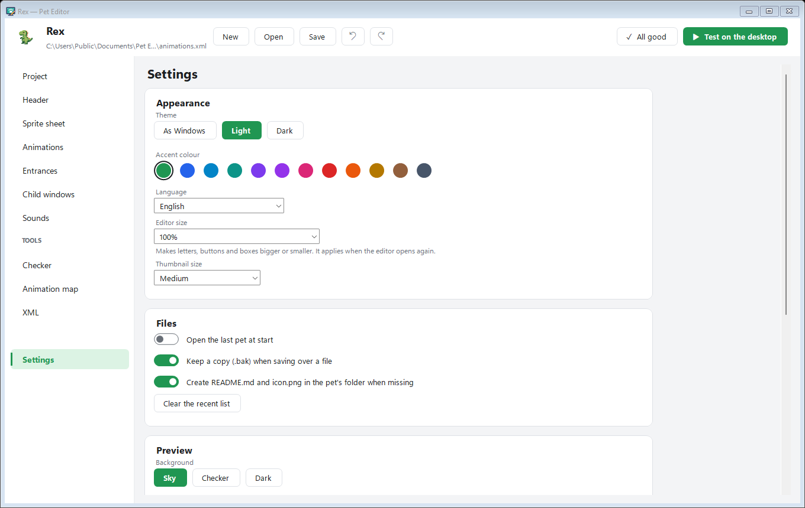

# Settings

[← Wiki home](Home.md) · [Português](pt-BR/Configuracoes.md)

## Appearance

| Setting | What it does |
| --- | --- |
| **Theme** | As Windows, Light or Dark. |
| **Accent colour** | The colour of buttons, marks and the selection. |
| **Language** | As Windows (Portuguese in a Portuguese Windows, English in any other), Português or English. Changes at once. |
| **Editor size** | *As Windows* (follows the zoom of Windows, for example 125%) or a size of its own: 80%, 90%, 100%, 110%, 125% or 150%. Letters, buttons and boxes grow or shrink. It applies when the editor opens again; it offers to reopen at once, on the same pet. |
| **Thumbnail size** | Small, medium or large frames in the lists and the sheet. |

## Files

| Setting | What it does |
| --- | --- |
| **Open the last pet at start** | Otherwise the editor starts on the Project page. |
| **Keep a copy (.bak) when saving over a file** | The old file is kept as `animations.xml.bak`. |
| **Create README.md and icon.png in the pet's folder when missing** | Written next to `animations.xml` when saving. |
| **Clear the recent list** | Empties *Recently opened* on the [Project](Project.md) page. |

## Preview

| Setting | What it does |
| --- | --- |
| **Background** | Sky, checker or dark, behind the [preview](Preview.md). |
| **Pet size** | 1x, 2x or 3x, like the *scale* option of DesktopPet. |
| **Play the sounds in the preview** | Off by default. |

## Test on the desktop

The `DesktopPet.exe` used by [Test on the desktop](Test-on-the-desktop.md). Empty = found by itself (next to the
editor, then in `Program Files\DesktopPet`, then in `%LocalAppData%\DesktopPet`). **Browse** chooses it by hand. The
line below says which one is used, or that none was found.

## About

The version of the editor, the keyboard shortcuts and **Show the tour again**.
