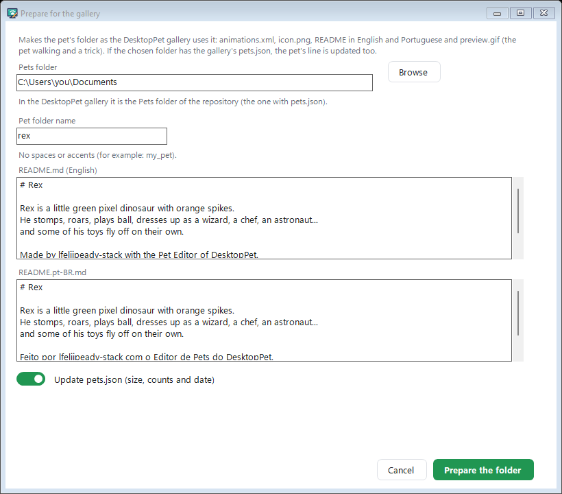
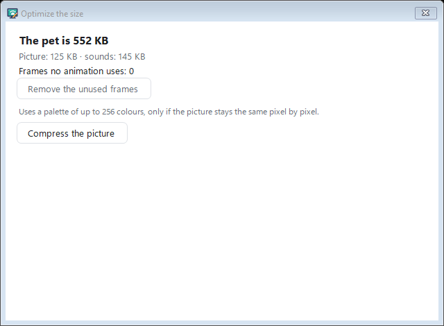

# Sharing a pet

[← Wiki home](Home.md) · [Português](pt-BR/Compartilhar.md)

## Export as .zip

**Project → Export as .zip** makes one file, ready to send by e-mail or chat. Inside is a folder with:

| File | What it is |
| --- | --- |
| `animations.xml` | The pet |
| `icon.png` | The icon (64 px) |
| `preview.gif` | An animated preview: the pet walking and one of its tricks |
| `README.md` and `README.pt-BR.md` | The name, the description and the author |

If the pet has errors, the editor asks first. Whoever gets the .zip unzips the folder into the pets of DesktopPet (or
opens the `animations.xml` in the editor).

## Prepare for the gallery

**Project → Prepare for the gallery** makes the pet's folder the way the
[DesktopPet gallery](https://github.com/lfeliipeadv-stack/meu-pet/tree/master/Pets) uses it.

| Field | What it is |
| --- | --- |
| **Pets folder** | Where the folder is made. In the DesktopPet gallery it is the `Pets` folder of the repository (the one with `pets.json`); the editor suggests it when it can find it. |
| **Pet folder name** | No spaces or accents (for example `my_pet`). |
| **README.md** / **README.pt-BR.md** | The texts of the READMEs, ready to edit. |
| **Update pets.json** | If the Pets folder has the gallery's `pets.json`, the pet's line is added or updated (size, counts and date). |

**Prepare the folder** writes `animations.xml`, `icon.png`, the two READMEs and `preview.gif`, opens the folder, and
the editor goes on with the copy in the gallery.

## Optimize the size

**Sprite sheet → Optimize the size…** makes the pet lighter to download.

- The size of the pet, of its picture and of its sounds.
- **Remove the unused frames**: frames no animation uses are removed and the others are renumbered (the animations
  keep showing the same frames). Not done for a pet with several skins, which need the same numbers.
- **Compress the picture**: saves the sheet with a palette of up to 256 colours, only if every pixel stays the same.
- Heavy sounds are listed, with the advice to lower their quality (64 kbps, mono) in an audio editor.
