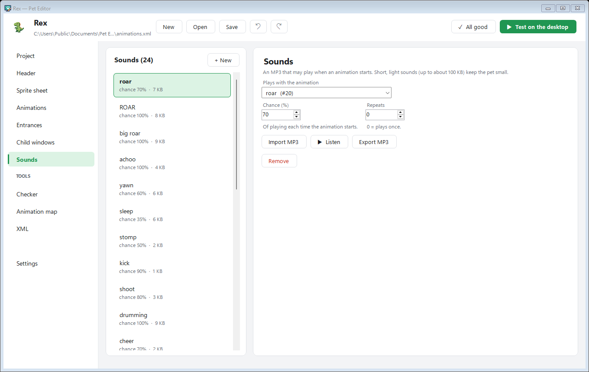

# Sounds

[← Wiki home](Home.md) · [Português](pt-BR/Sons.md)

An MP3 that may play when an animation starts. The sound is saved inside `animations.xml`.

| Field / button | What it is |
| --- | --- |
| **Plays with the animation** | The animation that plays the sound. |
| **Chance (%)** | Of playing each time the animation starts (100 = always). |
| **Repeats** | 0 = plays once. |
| **Import MP3** | Chooses the sound file. Sounds over about 100 KB make the pet heavy; the editor asks before using one. |
| **Listen** | Plays it. |
| **Export MP3** | Saves the sound as a file. |
| **Remove** | Takes the sound out of the pet. |

Short, light sounds keep the pet small: 64 kbps mono is enough. The [optimizer](Sharing.md#optimize-the-size) and the
[Checker](Checker.md) point out heavy sounds. In the [preview](Preview.md) sounds only play if
*Settings → Preview → Play the sounds in the preview* is on.
