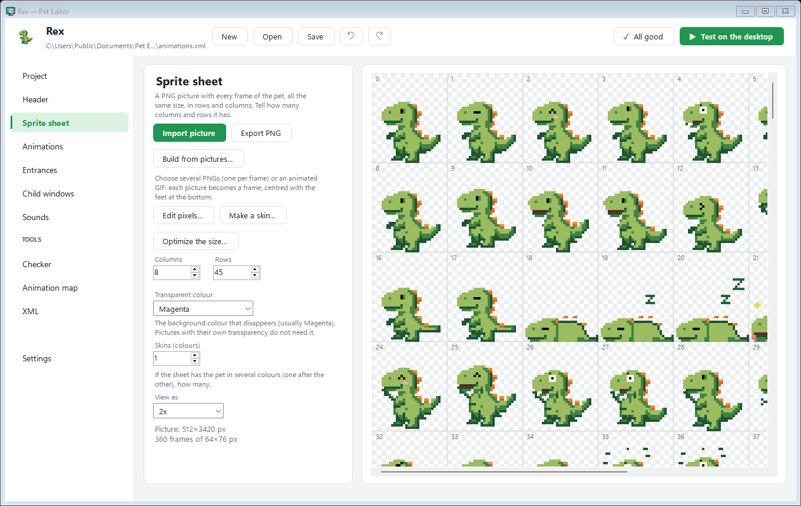
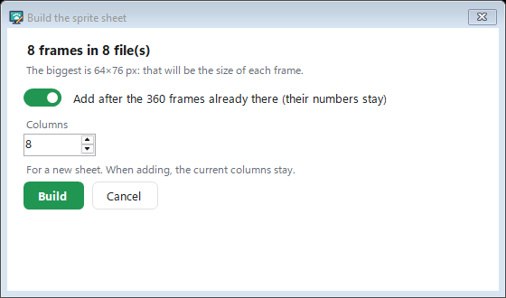

# Sprite sheet

[← Wiki home](Home.md) · [Português](pt-BR/Folha-de-sprites.md)

The sprite sheet is one PNG picture with every frame of the pet, all the same size, in rows and columns. Frames are
numbered from 0, left to right and top to bottom. The animations only say which frame numbers they show.

## Buttons

| Button | What it does |
| --- | --- |
| **Import picture** | Takes a PNG, GIF or BMP as the whole sheet. Then set the columns and rows. |
| **Export PNG** | Saves the sheet as a PNG (to draw on it in another program and import it again). |
| **Build from pictures…** | Makes the sheet from separate pictures or an animated GIF (below). |
| **Edit pixels…** | Choose a frame and retouch it ([Pixel editor](Pixel-editor-and-skins.md)). |
| **Make a skin…** | The pet in other colours ([Skins](Pixel-editor-and-skins.md#skins)). |
| **Optimize the size…** | Removes unused frames and compresses the picture ([Sharing](Sharing.md#optimize-the-size)). |

## The grid

| Field | What it is |
| --- | --- |
| **Columns** and **Rows** | How the picture is cut into frames. The size of a frame is the picture's width ÷ columns and height ÷ rows. If the picture does not split exactly, a warning shows under the fields and the [Checker](Checker.md) reports it. |
| **Transparent colour** | The background colour that disappears: Magenta (the usual one), Fuchsia, Lime, Cyan, White, Black or Transparent. Pictures with their own transparency (PNG with alpha) do not need it. |
| **Skins (colours)** | If the sheet has the pet in several colours, one after the other, how many. With 2 skins, the second half of the frames is the same pet in another colour, and DesktopPet chooses a skin for each pet on the screen. |
| **View as** | *Thumbnails* (each frame in a cell, the size chosen in [Settings](Settings.md)) or the whole sheet at 1x to 4x with its grid. |

Under the fields: the size of the picture and how many frames it has.

## Build from pictures

Choose several PNGs (one per frame) or an animated GIF. Each picture becomes a frame, centred, with the feet at the
bottom; the biggest picture gives the size of every frame. Pictures numbered in their names keep the number order.

- **Add after the frames already there**: the new frames get the next numbers, so the animations keep working. Turn it
  off to make a new sheet (then choose the columns).
- The window says how many frames will be made, and the numbers they get.

You can also drop the pictures on the window and choose *Add to the sprite sheet of this pet…*.

## Tips

- Draw the pet facing **left**: DesktopPet mirrors it when the pet turns.
- Keep frames small (the [Checker](Checker.md) warns about very big frames) and leave a little empty space around the
  drawing so it does not touch the edges of its cell.
- The feet should be on the same line in every frame, or the pet jumps up and down while it walks.
