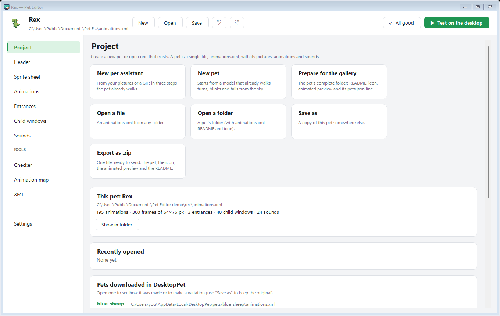
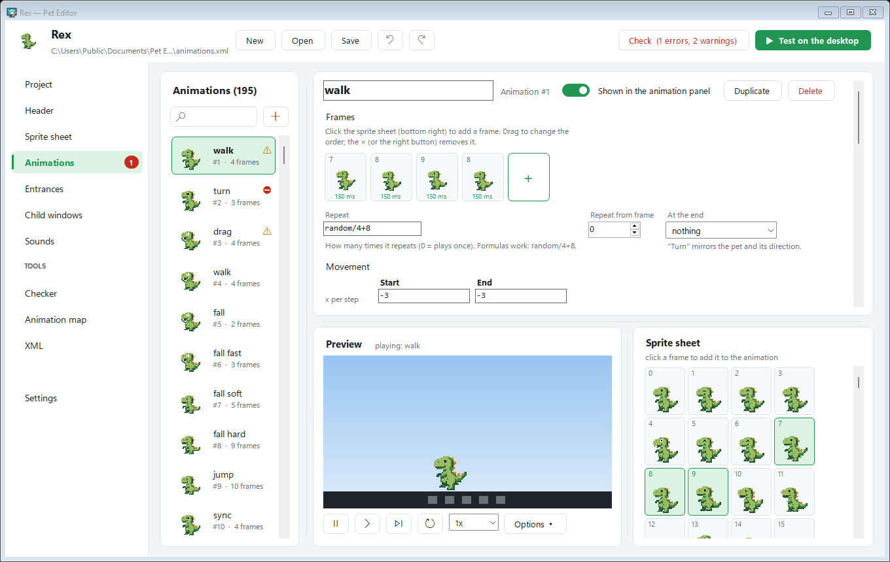
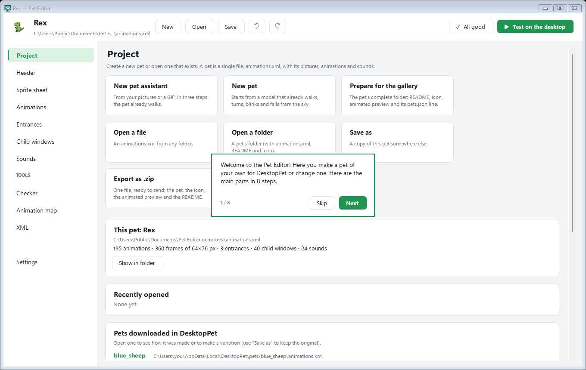
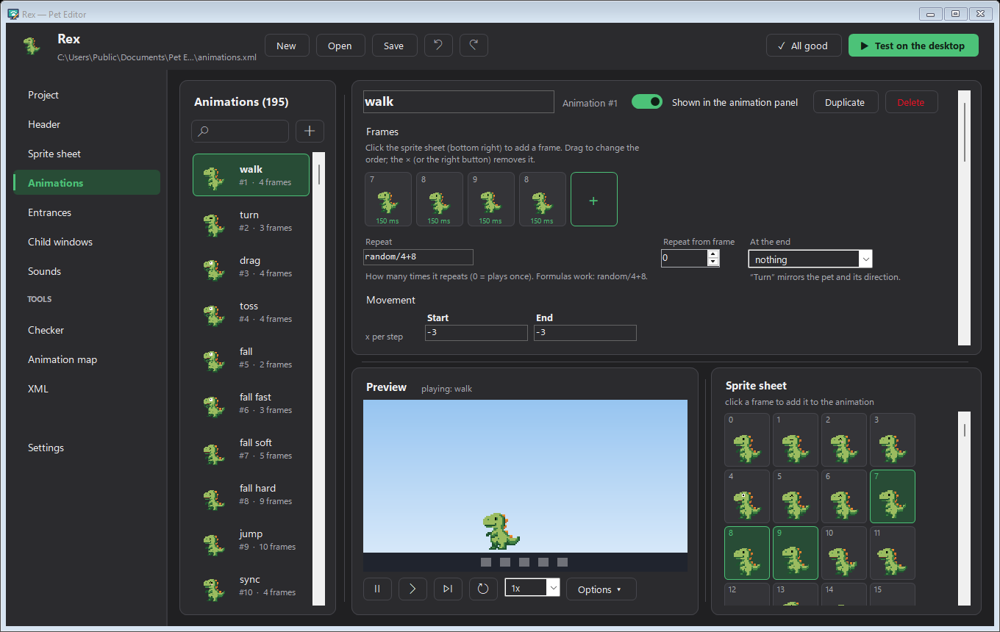

# The window

[← Wiki home](Home.md) · [Português](pt-BR/A-janela.md)

## The top bar

| Part | What it does |
| --- | --- |
| Icon, name and file | The pet that is open. A long path is shortened in the middle; the whole path shows under the mouse. A `•` before the name in the window title means there are changes not saved. |
| **New** | A menu: the *New pet assistant* or the *New pet* model ([Project](Project.md)). `Ctrl+N` |
| **Open** | Opens an `animations.xml`. `Ctrl+O` |
| **Save** | Saves the pet (`Ctrl+S`). The first time it asks where. `Ctrl+Shift+S` is *Save as*. |
| ↶ ↷ | Undo and redo every change, up to 80 steps (`Ctrl+Z`, `Ctrl+Y`). Typing in a box is grouped into one step. |
| **All good** / **Check (n errors, n warnings)** | The result of the [Checker](Checker.md), updated a moment after each change. Red when there are errors. Click to open the Checker. |
| **Test on the desktop** | Runs the pet in DesktopPet, updated with every change ([Test on the desktop](Test-on-the-desktop.md)). `F5` |

In a narrow window the name of the pet gives room to the buttons (it ends in "…").

## The side bar

The pages of the pet — [Project](Project.md), [Header](Header.md), [Sprite sheet](Sprite-sheet.md),
[Animations](Animations.md), [Entrances](Entrances.md), [Child windows](Child-windows.md), [Sounds](Sounds.md) — then
the **tools** — [Checker](Checker.md), [Animation map](Animation-map.md), [XML](XML.md) — and
[Settings](Settings.md) at the bottom. The mouse over an item shows what the page is for.

A coloured number next to a page is how many problems the Checker found there: **red** when there are errors,
**amber** when there are only warnings.

## The tour

The first time the editor opens, a balloon goes through the main parts in 8 steps (each page opens while it is
explained). **Next** (or `Enter` / `→`) goes on, **Skip** (or `Esc`) closes it. To see it again:
**Settings → About → Show the tour again**.

## Dropping files on the window

Drag files from the Explorer onto any part of the editor:

| You drop | The editor offers |
| --- | --- |
| Pictures (PNG, GIF, BMP, JPG) | *Make a new pet with these pictures (assistant)…* or *Add to the sprite sheet of this pet…* |
| An `animations.xml` or the folder of a pet | *Open the pet* or *Copy its animations into this pet…* |

## Size, theme and language

The editor follows the zoom of Windows (125% makes everything 25% bigger) or a size of its own, from 80% to 150%. It
has a light and a dark theme, accent colours, and is in English and Portuguese. All of it is in
[Settings](Settings.md).

## When the editor closes without saving

Every minute the editor keeps a copy of a pet with unsaved changes. If it closes unexpectedly (a crash, the computer
turned off), the next time it opens it asks whether to **recover the changes**. *Yes* opens the copy (it still has to
be saved), *No* throws it away, *Cancel* asks again next time.
