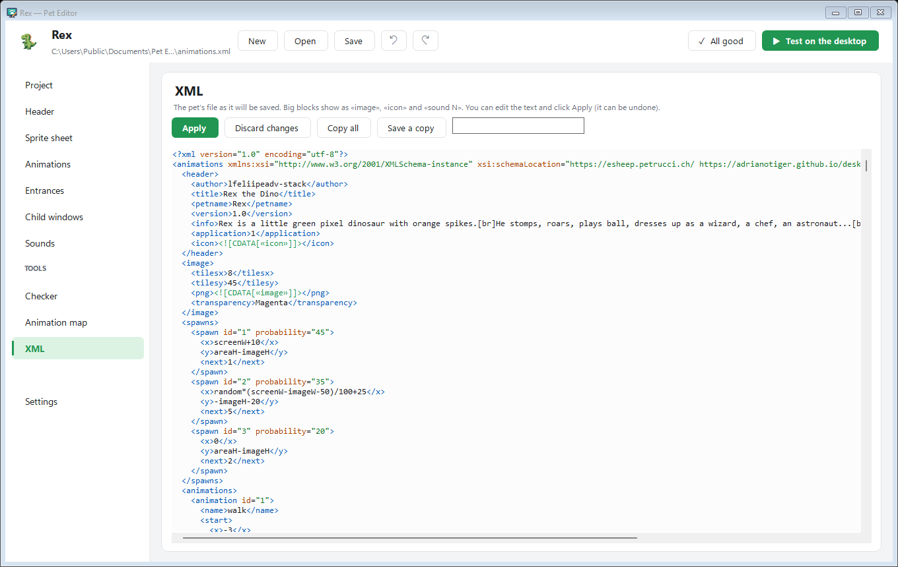

# XML

[← Wiki home](Home.md) · [Português](pt-BR/XML.md)

The pet's file as it will be saved, coloured, and editable by hand.

The big blocks (the picture, the icon and the sounds, which are long base64 texts) show as short marks: «image»,
«icon» and «sound N». Leave the marks as they are and the original blocks are kept.

| Button | What it does |
| --- | --- |
| **Apply** | Reads the edited text and replaces the pet with it (one step you can undo). |
| **Discard changes** | Shows the pet's XML again, without your edits. |
| **Copy all** | Copies the whole XML, with the real blocks, to the clipboard. |
| **Save a copy** | Saves the XML to a file. |
| Find box | Type and press `Enter` to find the next match. |

If you leave the page with edits not applied, the editor asks whether to apply them. If the text is not a valid pet
XML, it says so and nothing changes — check the `<` and `>` marks and the tag names.

What each tag means is on [The pet format](Pet-format.md).
