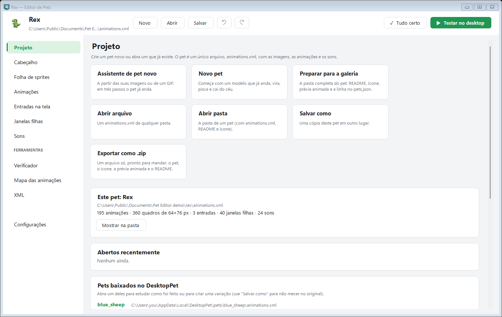
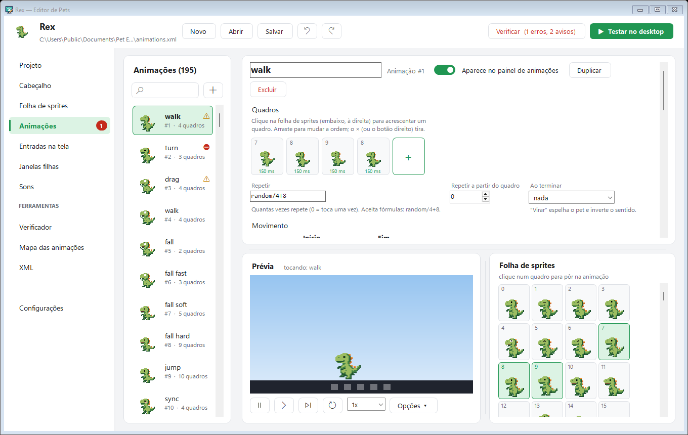
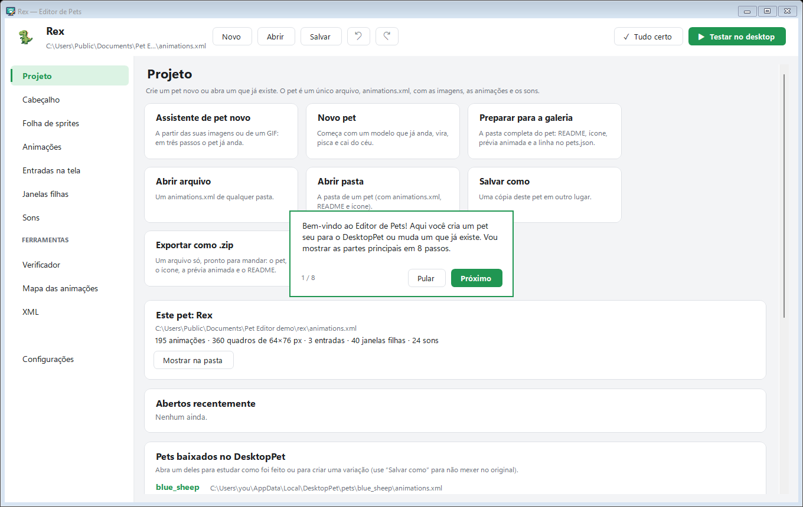
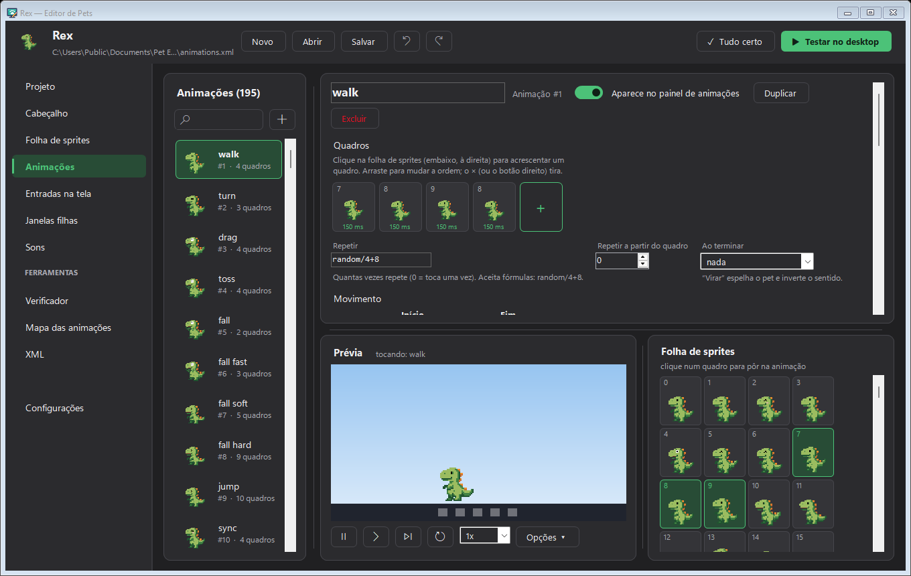

# A janela

[← Início do wiki](Home.md) · [English](../The-window.md)

## A barra de cima

| Parte | O que faz |
| --- | --- |
| Ícone, nome e arquivo | O pet que está aberto. Um caminho longo é encurtado no meio; o caminho inteiro aparece com o mouse em cima. Um `•` antes do nome, no título da janela, quer dizer que há mudanças não salvas. |
| **Novo** | Um menu: o *Assistente de pet novo* ou o modelo *Novo pet* ([Projeto](Projeto.md)). `Ctrl+N` |
| **Abrir** | Abre um `animations.xml`. `Ctrl+O` |
| **Salvar** | Salva o pet (`Ctrl+S`). Na primeira vez pergunta onde. `Ctrl+Shift+S` é *Salvar como*. |
| ↶ ↷ | Desfazer e refazer qualquer mudança, até 80 passos (`Ctrl+Z`, `Ctrl+Y`). O que se digita numa caixa vira um passo só. |
| **Tudo certo** / **Verificar (n erros, n avisos)** | O resultado do [Verificador](Verificador.md), atualizado um instante depois de cada mudança. Fica vermelho quando há erros. Clique para abrir o Verificador. |
| **Testar no desktop** | Roda o pet no DesktopPet, atualizado a cada mudança ([Testar no desktop](Testar-no-desktop.md)). `F5` |

Numa janela estreita, o nome do pet cede espaço para os botões (termina em "…").

## A barra lateral

As páginas do pet — [Projeto](Projeto.md), [Cabeçalho](Cabecalho.md), [Folha de sprites](Folha-de-sprites.md),
[Animações](Animacoes.md), [Entradas na tela](Entradas.md), [Janelas filhas](Janelas-filhas.md), [Sons](Sons.md) —,
depois as **ferramentas** — [Verificador](Verificador.md), [Mapa das animações](Mapa-das-animacoes.md), [XML](XML.md) —
e as [Configurações](Configuracoes.md) embaixo. O mouse em cima de um item diz para que serve a página.

Um número colorido ao lado de uma página é quantos problemas o Verificador achou ali: **vermelho** quando há erros,
**âmbar** quando há só avisos.

## O tour

Na primeira vez que o editor abre, um balão passa pelas partes principais em 8 passos (cada página abre enquanto é
explicada). **Próximo** (ou `Enter` / `→`) continua, **Pular** (ou `Esc`) fecha. Para ver de novo:
**Configurações → Sobre → Ver o tour de novo**.

## Soltar arquivos na janela

Arraste arquivos do Explorador para qualquer parte do editor:

| Você solta | O editor oferece |
| --- | --- |
| Imagens (PNG, GIF, BMP, JPG) | *Criar um pet novo com essas imagens (assistente)…* ou *Acrescentar à folha de sprites deste pet…* |
| Um `animations.xml` ou a pasta de um pet | *Abrir o pet* ou *Copiar animações dele para este pet…* |

## Tamanho, tema e idioma

O editor acompanha o zoom do Windows (125% deixa tudo 25% maior) ou usa um tamanho próprio, de 80% a 150%. Ele tem
tema claro e escuro, cores de destaque, e está em português e inglês. Tudo isso fica nas
[Configurações](Configuracoes.md).

## Quando o editor fecha sem salvar

A cada minuto, o editor guarda uma cópia do pet que tem mudanças não salvas. Se ele fechar de repente (um travamento,
o computador desligado), na próxima vez que abrir ele pergunta se quer **recuperar as mudanças**. *Sim* abre a cópia
(ainda é preciso salvar), *Não* descarta, *Cancelar* pergunta de novo na próxima vez.
