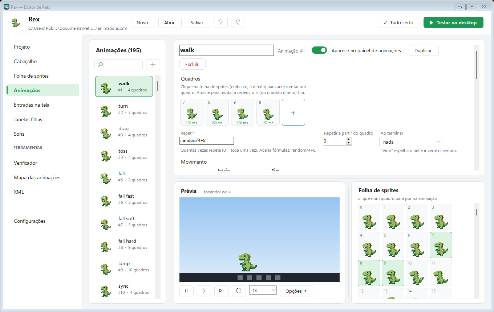
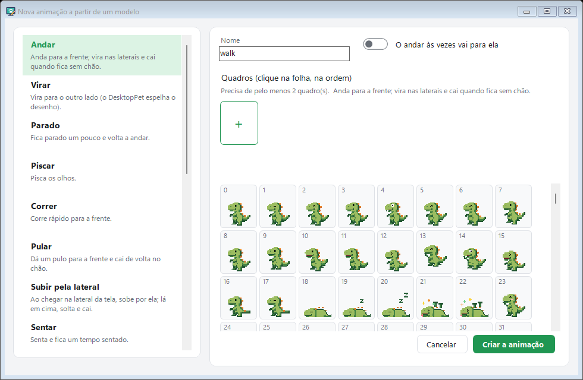
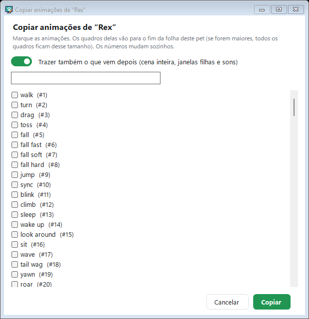
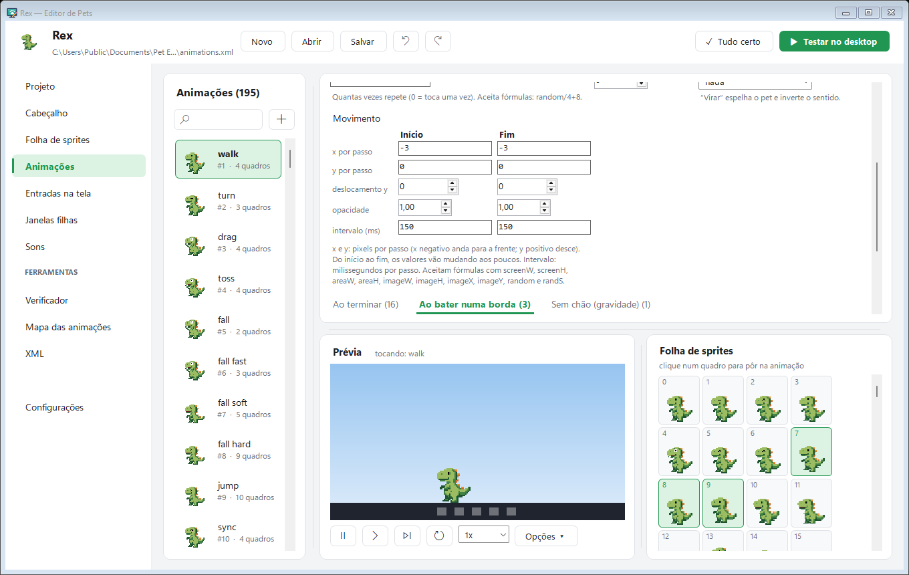

# Animações

[← Início do wiki](Home.md) · [English](../Animations.md)

O coração do pet. Cada animação é uma lista de quadros, um movimento e o que vem depois dela. O DesktopPet toca uma
animação de cada vez e depois escolhe a próxima.

A página tem quatro partes, com divisórias que você pode arrastar (o lugar delas é lembrado):

1. a **lista** de animações (à esquerda);
2. o **editor** da escolhida (em cima, à direita);
3. a [prévia](Previa.md) (embaixo);
4. a **folha de sprites**, para clicar nos quadros e pô-los na animação (embaixo, à direita).

## A lista

- Cada linha mostra o primeiro quadro, o nome, o número (`#1`) e quantos quadros a animação tem. *fora do painel* quer
  dizer que ela não aparece no painel de animações do DesktopPet.
- A **caixa de busca** acha por parte do nome ou pelo número. `Esc` limpa.
- Um ⛔ ou ⚠ à direita quer dizer que o [Verificador](Verificador.md) achou um problema nessa animação; o mouse em cima
  da linha mostra o nome inteiro e os problemas.
- `Delete` exclui a animação escolhida (pergunta antes).

## Animações novas

O botão **+** em cima da lista abre um menu:

| Escolha | O que faz |
| --- | --- |
| **Em branco** | Uma animação vazia, para preencher à mão. |
| **A partir de um modelo pronto…** | Um comportamento já montado (andar, virar, correr, pular, subir, sentar, dormir, dançar…) com os seus quadros. |
| **Copiar de outro pet…** | Animações de outro `animations.xml`, com os quadros delas. |

### A partir de um modelo pronto

Escolha um modelo à esquerda, dê um nome e clique nos quadros dele na folha, na ordem (a janela diz quantos são
precisos). **O andar às vezes vai para ela** põe a animação entre as que o andar sorteia de vez em quando (bom para
truques como piscar, sentar ou dançar). **Criar a animação** acrescenta a animação com o movimento e as próximas já
prontos.

| Modelo | O que faz |
| --- | --- |
| Andar | Anda para a frente; vira nas laterais e cai quando fica sem chão. |
| Virar | Vira para o outro lado (o DesktopPet espelha o desenho). |
| Parado | Fica parado um pouco e volta a andar. |
| Piscar | Pisca os olhos. |
| Correr | Corre rápido para a frente. |
| Pular | Dá um pulo para a frente e cai de volta no chão. |
| Subir pela lateral | Ao chegar na lateral da tela, sobe por ela; lá em cima, solta e cai. |
| Sentar | Senta e fica um tempo sentado. |
| Dormir | Dorme um bom tempo (o DesktopPet também usa quando você pede para ele dormir). |
| Feliz | Mostra que está feliz (o DesktopPet usa nas reações). |
| Dançar | Dança no lugar. |
| Falar | Mexe a boca: o DesktopPet usa enquanto mostra um balão. |
| Cair | Cai cada vez mais rápido até o chão ou uma janela (usado quando o pet é solto). |
| Pousar | Chega ao chão depois de cair ou de ser jogado. |
| Ser pego | Enquanto o mouse segura o pet. |
| Ir embora | Some aos poucos quando o pet vai embora. |

### Copiar de outro pet

Escolha o `animations.xml` do outro pet e marque as animações. Os quadros delas vão para o fim da folha deste pet (se
forem maiores, todos os quadros ficam desse tamanho) e os números mudam sozinhos. **Trazer também o que vem depois**
copia ainda as animações a que elas levam (a cena inteira), as janelas filhas e os sons. Animações que os dois pets têm
com o mesmo nome são ligadas, em vez de copiadas de novo.

## O editor de uma animação

| Parte | O que é |
| --- | --- |
| **Nome** | O nome que o DesktopPet usa. Alguns nomes têm um sentido especial (abaixo). |
| **Animação #n** | O número dela, usado nas listas de próximas, nas entradas, nas janelas filhas e nos sons. |
| **Aparece no painel de animações** | Se ela aparece na lista em que quem usa o DesktopPet escolhe uma animação à mão. |
| **Duplicar** | Uma cópia com um número novo. |
| **Excluir** | Tira a animação. Se algo a usa (outra animação, uma entrada, uma janela filha, um som), o editor diz o quê, e ela sai também dessas listas. |

### Quadros

Clique nos quadros da folha de sprites (embaixo, à direita) para acrescentá-los. Na faixa:

- arraste um quadro para mudar a ordem; o **×** dele (ou o botão direito → *Tirar da animação*) tira;
- embaixo de cada quadro está quanto tempo ele fica na tela, em milissegundos;
- o cartão **+** lembra que é para clicar na folha;
- o **botão direito** num quadro abre: *Segurar mais (2× / 3×)* (repete o quadro no lugar), *Repetir no fim*,
  *Editar os pixels deste quadro…*, *Inverter a ordem* e *Tirar da animação*.

### Repetição

| Campo | O que é |
| --- | --- |
| **Repetir** | Quantas vezes os quadros se repetem (0 = toca uma vez). Aceita [fórmula](Formulas.md): `random/4+8` repete de 8 a 32 vezes. |
| **Repetir a partir do quadro** | De onde a repetição recomeça (0 = do primeiro quadro). Use para uma animação com um começo que toca uma vez e um meio que se repete. |
| **Ao terminar** | *nada*, ou *virar (flip)*: espelha o pet e inverte o sentido quando a animação termina. |

### Movimento

Uma coluna para o **início** e outra para o **fim**; os valores vão mudando aos poucos de um para o outro ao longo de
todos os passos da animação.

| Linha | O que é |
| --- | --- |
| **x por passo** | Pixels para o lado a cada passo. Negativo anda **para a frente** (o desenho olha para a esquerda). |
| **y por passo** | Pixels para cima ou para baixo a cada passo. Positivo **desce**. |
| **deslocamento y** | Sobe ou desce o desenho sem mover o pet (para quadros desenhados mais altos ou mais baixos). |
| **opacidade** | De 0 (invisível) a 1 (sólido). De 1 para 0 faz o pet sumir aos poucos. |
| **intervalo (ms)** | Milissegundos por passo: menor é mais rápido. Aceita [fórmula](Formulas.md). |

### O que vem depois

Três abas, com o número de escolhas de cada uma:

| Aba | Quando é usada |
| --- | --- |
| **Ao terminar** | Quando a animação termina. |
| **Ao bater numa borda** | Quando o pet bate numa borda enquanto se move: uma lateral da tela, a barra de tarefas, o topo de uma janela… |
| **Sem chão (gravidade)** | Quando não há nada embaixo do pet (ele saiu andando de uma janela). |

Cada linha é uma escolha: a animação, **onde vale**, a **chance** e uma barra com a parte dela. O DesktopPet sorteia
uma pelas chances. *acrescentar próxima* põe uma linha; o **×** tira.

| Onde vale | A escolha conta… |
| --- | --- |
| em qualquer lugar | sempre |
| só na barra de tarefas | quando o pet está na barra de tarefas |
| só em cima de janela | quando o pet está em cima de uma janela |
| só borda de cima/baixo | na borda de cima ou de baixo |
| só laterais da tela | na lateral esquerda ou direita da tela |
| lateral de janela | na lateral de uma janela |
| lado de outro pet | ao lado de outro pet |

Sem nenhuma escolha *Ao terminar*, o pet reaparece em outro lugar (por uma [entrada](Entradas.md)).

## Nomes com sentido especial

O DesktopPet procura estes nomes; o editor explica cada um embaixo do nome quando você o usa.

| Nome | Quando o DesktopPet toca |
| --- | --- |
| `drag` | enquanto o pet é segurado com o mouse |
| `fall` | quando é solto, ou fica sem chão |
| `toss` | enquanto o pet voa depois de ser jogado |
| `fall soft` | quando o pet jogado cai devagar |
| `fall hard` | quando o pet jogado cai com força |
| `kill` | quando o pet vai embora (fechando o programa ou trocando de pet) |
| `sync` | por todos os pets ao mesmo tempo |

O [Verificador](Verificador.md) avisa quando falta um deles (o DesktopPet usa então um simples).
