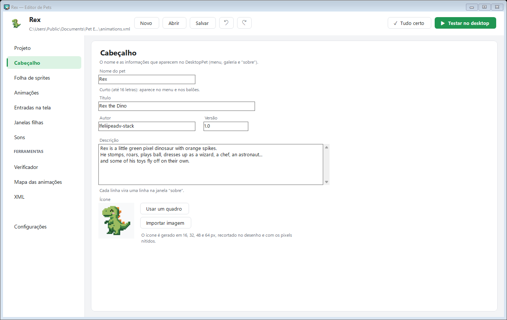
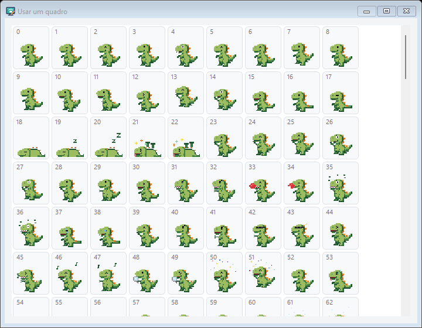

# Cabeçalho

[← Início do wiki](Home.md) · [English](../Header.md)

O nome e as informações que o DesktopPet mostra: no menu, na galeria e na janela "sobre".

| Campo | O que é |
| --- | --- |
| **Nome do pet** | Curto, até 16 letras. Aparece no menu do DesktopPet e nos balões. O [Verificador](Verificador.md) avisa quando está vazio. |
| **Título** | O nome completo (por exemplo *Rex the Dino*). |
| **Autor** | Quem fez o pet. |
| **Versão** | A sua numeração (por exemplo `1.0`, `1.1`). Aumente quando mudar um pet que outras pessoas já usam. |
| **Descrição** | Algumas linhas sobre o pet. Cada linha vira uma linha na janela "sobre" (é salva com `[br]` entre as linhas). |
| **Ícone** | A imagem do pet nos menus e nas listas. |

## O ícone

- **Usar um quadro** abre a folha de sprites: clique no quadro que vira o ícone.
- **Importar imagem** usa um PNG, ICO, BMP ou GIF.

Nos dois casos, o ícone é gerado em 16, 32, 48 e 64 px, recortado no desenho (a borda vazia é cortada) e com os pixels
nítidos.

