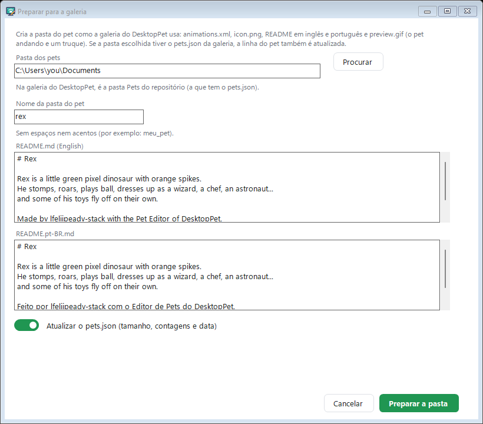
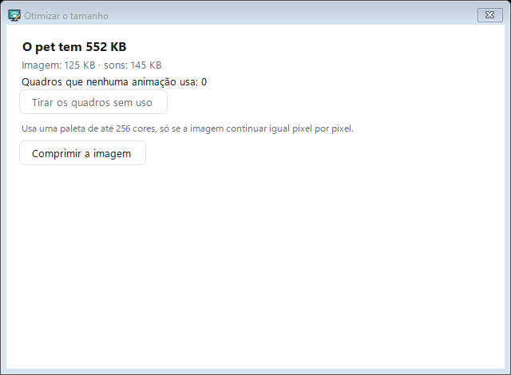

# Compartilhar um pet

[← Início do wiki](Home.md) · [English](../Sharing.md)

## Exportar como .zip

**Projeto → Exportar como .zip** faz um arquivo só, pronto para mandar por e-mail ou mensagem. Dentro dele há uma pasta
com:

| Arquivo | O que é |
| --- | --- |
| `animations.xml` | O pet |
| `icon.png` | O ícone (64 px) |
| `preview.gif` | Uma prévia animada: o pet andando e um dos truques dele |
| `README.md` e `README.pt-BR.md` | O nome, a descrição e o autor |

Se o pet tem erros, o editor pergunta antes. Quem receber o .zip descompacta a pasta dentro dos pets do DesktopPet (ou
abre o `animations.xml` no editor).

## Preparar para a galeria

**Projeto → Preparar para a galeria** cria a pasta do pet do jeito que a
[galeria do DesktopPet](https://github.com/lfeliipeadv-stack/meu-pet/tree/master/Pets) usa.

| Campo | O que é |
| --- | --- |
| **Pasta dos pets** | Onde a pasta é criada. Na galeria do DesktopPet, é a pasta `Pets` do repositório (a que tem o `pets.json`); o editor sugere essa pasta quando consegue achá-la. |
| **Nome da pasta do pet** | Sem espaços nem acentos (por exemplo `meu_pet`). |
| **README.md** / **README.pt-BR.md** | Os textos dos READMEs, prontos para editar. |
| **Atualizar o pets.json** | Se a pasta dos pets tem o `pets.json` da galeria, a linha do pet é criada ou atualizada (tamanho, contagens e data). |

**Preparar a pasta** grava o `animations.xml`, o `icon.png`, os dois READMEs e o `preview.gif`, abre a pasta, e o editor
continua com a cópia da galeria.

## Otimizar o tamanho

**Folha de sprites → Otimizar o tamanho…** deixa o pet mais leve para baixar.

- O tamanho do pet, da imagem e dos sons.
- **Tirar os quadros sem uso**: os quadros que nenhuma animação usa saem e os outros são renumerados (as animações
  continuam mostrando os mesmos quadros). Não é feito num pet com várias skins, que precisam dos mesmos números.
- **Comprimir a imagem**: grava a folha com uma paleta de até 256 cores, só se todos os pixels continuarem iguais.
- Os sons pesados são listados, com a dica de diminuir a qualidade (64 kbps, mono) num editor de áudio.
