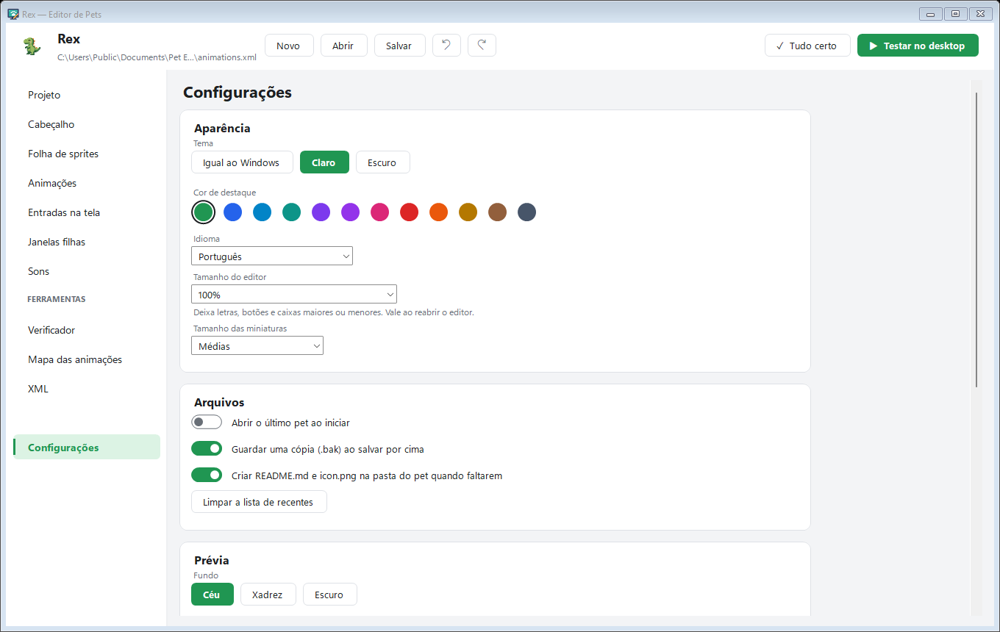

# Configurações

[← Início do wiki](Home.md) · [English](../Settings.md)

## Aparência

| Configuração | O que faz |
| --- | --- |
| **Tema** | Igual ao Windows, Claro ou Escuro. |
| **Cor de destaque** | A cor dos botões, das marcas e da seleção. |
| **Idioma** | Igual ao Windows (português num Windows em português, inglês em qualquer outro), Português ou English. Muda na hora. |
| **Tamanho do editor** | *Igual ao Windows* (acompanha o zoom do Windows, por exemplo 125%) ou um tamanho próprio: 80%, 90%, 100%, 110%, 125% ou 150%. Letras, botões e caixas crescem ou diminuem. Vale ao reabrir o editor; ele oferece reabrir na hora, no mesmo pet. |
| **Tamanho das miniaturas** | Quadros pequenos, médios ou grandes nas listas e na folha. |

## Arquivos

| Configuração | O que faz |
| --- | --- |
| **Abrir o último pet ao iniciar** | Senão, o editor começa na página Projeto. |
| **Guardar uma cópia (.bak) ao salvar por cima** | O arquivo antigo fica como `animations.xml.bak`. |
| **Criar README.md e icon.png na pasta do pet quando faltarem** | Gravados ao lado do `animations.xml` ao salvar. |
| **Limpar a lista de recentes** | Esvazia *Abertos recentemente* na página [Projeto](Projeto.md). |

## Prévia

| Configuração | O que faz |
| --- | --- |
| **Fundo** | Céu, xadrez ou escuro, atrás da [prévia](Previa.md). |
| **Tamanho do pet** | 1x, 2x ou 3x, como a opção *escala* do DesktopPet. |
| **Tocar os sons na prévia** | Desligado no começo. |

## Testar no desktop

O `DesktopPet.exe` usado em [Testar no desktop](Testar-no-desktop.md). Vazio = encontrado sozinho (ao lado do editor,
depois em `Program Files\DesktopPet`, depois em `%LocalAppData%\DesktopPet`). **Procurar** escolhe à mão. A linha de
baixo diz qual está sendo usado, ou que nenhum foi encontrado.

## Sobre

A versão do editor, os atalhos de teclado e **Ver o tour de novo**.
