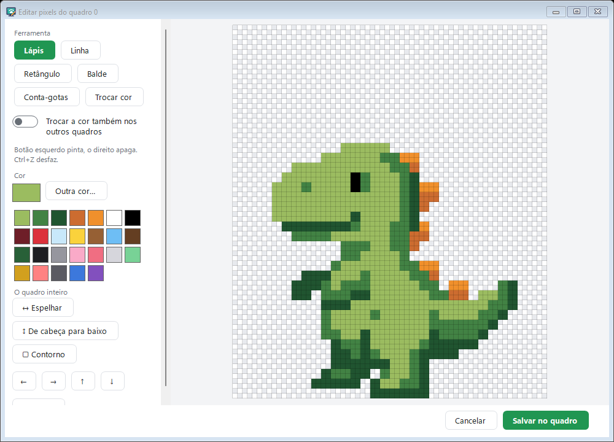
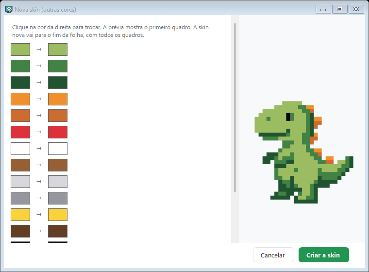

# Editor de pixels e skins

[← Início do wiki](Home.md) · [English](../Pixel-editor-and-skins.md)

## Editor de pixels

Pequenos retoques num quadro sem sair do editor. Abra por **Folha de sprites → Editar pixels…** (e clique num quadro),
ou com o botão direito num quadro de uma animação → *Editar os pixels deste quadro…*.

O quadro aparece grande, com a grade de pixels. O botão **esquerdo** pinta, o **direito** apaga (deixa o pixel
transparente). `Ctrl+Z` desfaz, até 60 passos.

| Ferramenta | O que faz |
| --- | --- |
| **Lápis** | Pinta um pixel de cada vez (arraste para pintar mais). |
| **Linha** | Arraste do primeiro ao último pixel da linha. |
| **Retângulo** | Arraste de um canto ao outro: o contorno de um retângulo. |
| **Balde** | Pinta a área da mesma cor. |
| **Conta-gotas** | Pega a cor de um pixel. |
| **Trocar cor** | Clique numa cor: ela vira a cor escolhida no quadro inteiro. Com **Trocar a cor também nos outros quadros** ligado, todos os quadros do pet mudam ao salvar. |

**Cor**: o quadrado é a cor escolhida; **Outra cor…** abre o seletor de cores do Windows; embaixo ficam as cores do pet,
as mais usadas primeiro.

**O quadro inteiro**: **Espelhar** (esquerda ↔ direita), **De cabeça para baixo**, **Contorno** (uma borda de 1 pixel na
cor escolhida em volta do desenho) e as setas **← → ↑ ↓** movem o desenho um pixel.

**Salvar no quadro** grava na folha de sprites (um passo que dá para desfazer no editor). **Cancelar** descarta.

## Skins

Uma skin é o mesmo pet em outras cores. O DesktopPet escolhe uma skin para cada pet na tela, então dois iguais ficam
diferentes. Abra por **Folha de sprites → Criar uma skin…**.

As cores principais do pet ficam listadas à esquerda. Clique na cor da direita de uma linha para trocá-la; a prévia
mostra o primeiro quadro. **Criar a skin** acrescenta uma cópia de todos os quadros, nas cores novas, no fim da folha,
e aumenta *Skins* na página [Folha de sprites](Folha-de-sprites.md). Troque pelo menos uma cor.
