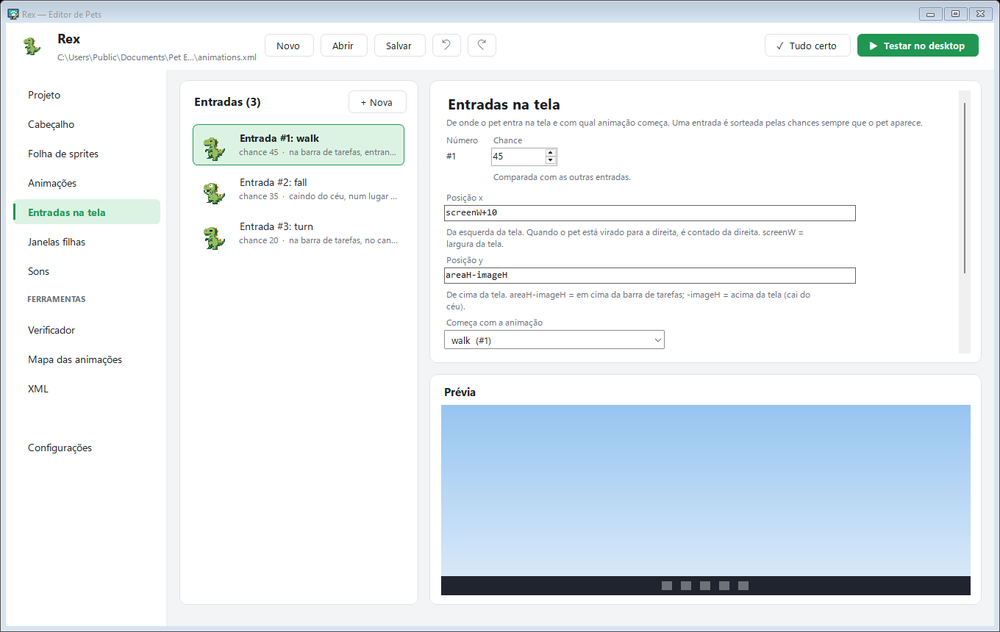

# Entradas na tela

[← Início do wiki](Home.md) · [English](../Entrances.md)

De onde o pet entra na tela e com qual animação começa. Sempre que o pet aparece, o DesktopPet sorteia uma entrada pela
chance dela.

A lista à esquerda mostra cada entrada com a chance e onde ela fica, em palavras (*na barra de tarefas*, *caindo do
céu*, *entrando pela lateral*…). **+ Nova** acrescenta uma; **Remover** (ou `Delete`) tira a escolhida.

| Campo | O que é |
| --- | --- |
| **Número** | O número da entrada. |
| **Chance** | Comparada com as outras entradas: 40, 30 e 30 quer dizer 40%, 30% e 30%. |
| **Posição x** | Da esquerda da tela. Quando o pet está virado para a direita, é contada da direita. `screenW` = largura da tela. |
| **Posição y** | De cima da tela. `areaH-imageH` = em cima da barra de tarefas; `-imageH` = acima da tela (cai do céu). |
| **Começa com a animação** | A primeira animação tocada. |

**Posições prontas** preenchem x e y com os lugares de costume: *Na barra de tarefas*, *Entrando pela lateral*, *Caindo
do céu*. **Testar esta entrada** mostra a entrada na prévia à direita.

As posições são [fórmulas](Formulas.md). Algumas úteis:

| Lugar | x | y |
| --- | --- | --- |
| Na barra de tarefas, entrando pela direita | `screenW` | `areaH-imageH` |
| Caindo do céu num lugar qualquer | `random*(screenW-imageW-50)/100+25` | `-imageH` |
| Na barra de tarefas num lugar qualquer | `random*(screenW-imageW-50)/100+25` | `areaH-imageH` |

Um pet sem nenhuma entrada não aparece; o [Verificador](Verificador.md) avisa.
