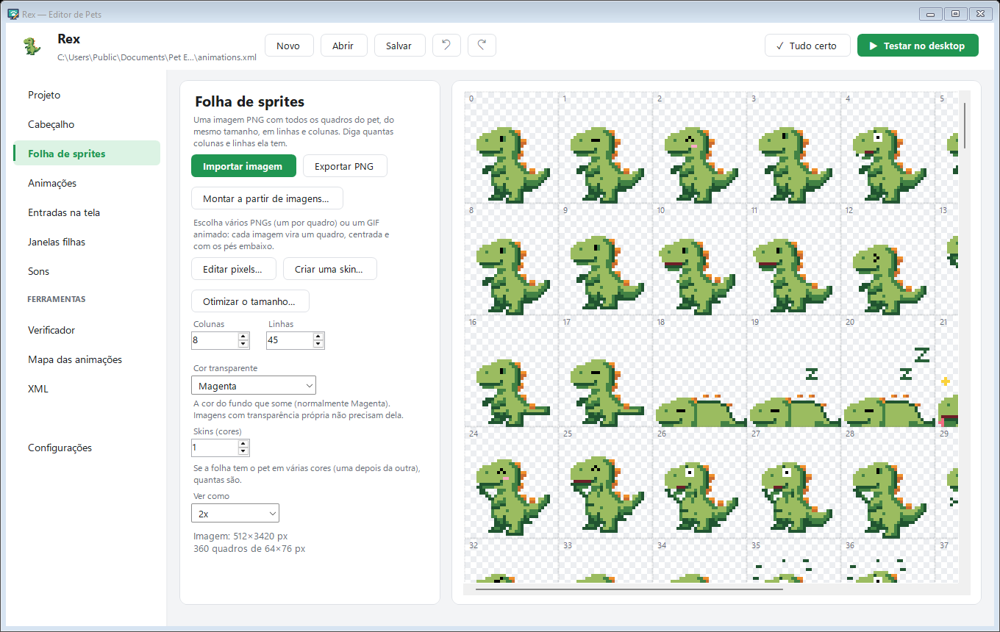
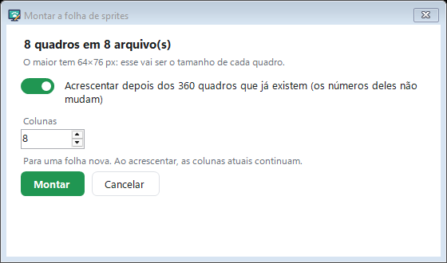

# Folha de sprites

[← Início do wiki](Home.md) · [English](../Sprite-sheet.md)

A folha de sprites é uma imagem PNG com todos os quadros do pet, do mesmo tamanho, em linhas e colunas. Os quadros são
numerados a partir de 0, da esquerda para a direita e de cima para baixo. As animações só dizem quais números de
quadro mostram.

## Botões

| Botão | O que faz |
| --- | --- |
| **Importar imagem** | Usa um PNG, GIF ou BMP como a folha inteira. Depois, ajuste as colunas e linhas. |
| **Exportar PNG** | Salva a folha como PNG (para desenhar nela em outro programa e importar de novo). |
| **Montar a partir de imagens…** | Faz a folha a partir de imagens separadas ou de um GIF animado (abaixo). |
| **Editar pixels…** | Escolha um quadro e retoque ([Editor de pixels](Editor-de-pixels-e-skins.md)). |
| **Criar uma skin…** | O pet em outras cores ([Skins](Editor-de-pixels-e-skins.md#skins)). |
| **Otimizar o tamanho…** | Tira quadros sem uso e comprime a imagem ([Compartilhar](Compartilhar.md#otimizar-o-tamanho)). |

## A grade

| Campo | O que é |
| --- | --- |
| **Colunas** e **Linhas** | Como a imagem é cortada em quadros. O tamanho de um quadro é a largura da imagem ÷ colunas e a altura ÷ linhas. Se a imagem não se divide exatamente, aparece um aviso embaixo dos campos e o [Verificador](Verificador.md) também avisa. |
| **Cor transparente** | A cor do fundo que some: Magenta (a de costume), Fuchsia, Lime, Cyan, White, Black ou Transparent. Imagens com transparência própria (PNG com canal alfa) não precisam dela. |
| **Skins (cores)** | Se a folha tem o pet em várias cores, uma depois da outra, quantas são. Com 2 skins, a segunda metade dos quadros é o mesmo pet em outra cor, e o DesktopPet escolhe uma skin para cada pet na tela. |
| **Ver como** | *Miniaturas* (cada quadro numa célula, do tamanho escolhido nas [Configurações](Configuracoes.md)) ou a folha inteira em 1x a 4x com a grade. |

Embaixo dos campos: o tamanho da imagem e quantos quadros ela tem.

## Montar a partir de imagens

Escolha vários PNGs (um por quadro) ou um GIF animado. Cada imagem vira um quadro, centrada e com os pés embaixo; a
maior imagem dá o tamanho de todos os quadros. Imagens com números no nome ficam na ordem dos números.

- **Acrescentar depois dos quadros que já existem**: os quadros novos ganham os números seguintes, e as animações
  continuam funcionando. Desligue para fazer uma folha nova (aí escolha as colunas).
- A janela diz quantos quadros vão ser feitos e os números que eles ganham.

Também dá para soltar as imagens na janela e escolher *Acrescentar à folha de sprites deste pet…*.

## Dicas

- Desenhe o pet olhando para a **esquerda**: o DesktopPet espelha quando o pet vira.
- Use quadros pequenos (o [Verificador](Verificador.md) avisa quando são grandes demais) e deixe um pouco de espaço
  vazio em volta do desenho, para ele não encostar nas bordas da célula.
- Os pés devem ficar na mesma linha em todos os quadros, senão o pet sobe e desce enquanto anda.
