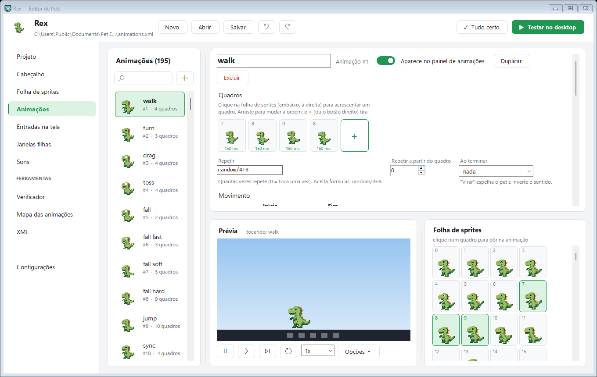

# Editor de Pets — Wiki

[English](../Home.md) · **Português**

O **Editor de Pets** é um programa para Windows que cria e edita pets de área de trabalho: os bichinhos animados do
[DesktopPet](https://github.com/lfeliipeadv-stack/meu-pet) que andam pelas suas janelas, caem na barra de tarefas e
podem ser pegos com o mouse. Um pet é um único arquivo, `animations.xml`, com as imagens, as animações e os sons dentro.
O editor mostra cada parte numa página própria e toca o pet numa prévia ao vivo enquanto você mexe nele.

## Comece por aqui

| Página | O que tem |
| --- | --- |
| [Instalação](Instalacao.md) | O que é preciso, onde baixar, onde ficam as configurações |
| [Primeiros passos](Primeiros-passos.md) | O seu primeiro pet em três passos, com o assistente |
| [A janela](A-janela.md) | A barra de cima, a barra lateral, os números de problemas, o tour, soltar arquivos |

## As páginas do editor

| Página | O que tem |
| --- | --- |
| [Projeto](Projeto.md) | Pet novo, abrir, recentes, os pets baixados no DesktopPet, salvar como, exportar |
| [Cabeçalho](Cabecalho.md) | Nome, título, autor, versão, descrição e ícone |
| [Folha de sprites](Folha-de-sprites.md) | A imagem com todos os quadros: importar, montar a partir de imagens, grade, transparência, skins |
| [Animações](Animacoes.md) | Quadros, repetição, movimento, o que vem depois, modelos prontos, copiar de outro pet |
| [Prévia](Previa.md) | A prévia ao vivo: botões, opções, o mouse, a janela de teste |
| [Entradas na tela](Entradas.md) | De onde o pet entra na tela |
| [Janelas filhas](Janelas-filhas.md) | Uma segunda imagem que aparece com uma animação |
| [Sons](Sons.md) | Sons MP3 tocados com as animações |
| [Verificador](Verificador.md) | Todos os erros e avisos que o editor encontra, e o que fazer |
| [Mapa das animações](Mapa-das-animacoes.md) | Todas as animações e as setas para o que vem depois |
| [XML](XML.md) | O arquivo como vai ser salvo, editável à mão |
| [Configurações](Configuracoes.md) | Tema, cores, idioma, tamanho, arquivos, prévia e o DesktopPet dos testes |

## Ferramentas

| Página | O que tem |
| --- | --- |
| [Editor de pixels e skins](Editor-de-pixels-e-skins.md) | Retocar um quadro; o mesmo pet em outras cores |
| [Testar no desktop](Testar-no-desktop.md) | Ver o pet de verdade na sua tela, atualizado a cada mudança |
| [Compartilhar um pet](Compartilhar.md) | Exportar como .zip, preparar para a galeria, otimizar o tamanho |

## Referência

| Página | O que tem |
| --- | --- |
| [Fórmulas](Formulas.md) | `screenW`, `areaH`, `imageX`, `random`… o que cada palavra quer dizer |
| [Teclado e mouse](Teclado-e-mouse.md) | Todos os atalhos |
| [O formato do pet](Formato-do-pet.md) | O que há dentro do `animations.xml` |
| [Perguntas frequentes](Perguntas-frequentes.md) | Dúvidas e problemas comuns |
| [Para desenvolvedores](Para-desenvolvedores.md) | Compilar, testar, as opções do `PetEditor.exe`, o código |
