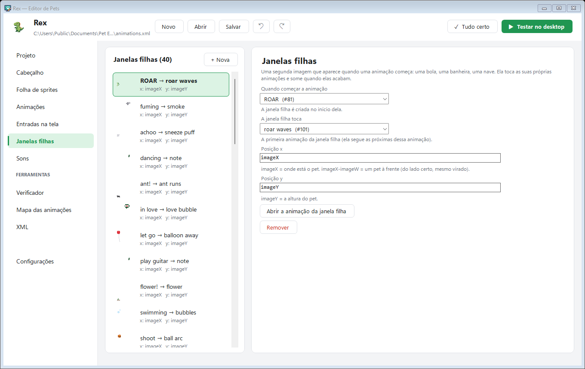

# Janelas filhas

[← Início do wiki](Home.md) · [English](../Child-windows.md)

Uma janela filha é uma segunda imagem que aparece quando uma animação começa: uma bola que o pet chuta, uma banheira,
uma nave, uma nuvem de fumaça. Ela toca as suas próprias animações (feitas com quadros da mesma folha de sprites) e
some quando elas terminam.

A lista mostra cada janela filha como *animação que a cria → animação que ela toca*. **+ Nova** acrescenta uma;
**Remover** (ou `Delete`) tira.

| Campo | O que é |
| --- | --- |
| **Quando começar a animação** | A animação do pet que cria a janela filha. |
| **A janela filha toca** | A primeira animação dela. Depois ela segue as próximas dessa animação, como o pet. |
| **Posição x** | `imageX` = onde está o pet. `imageX-imageW` = um pet à frente (do lado certo, mesmo virado). |
| **Posição y** | `imageY` = a altura do pet na tela. |
| **Abrir a animação da janela filha** | Vai para essa animação na página [Animações](Animacoes.md). |

## Como fazer uma

1. Desenhe os quadros do objeto na [folha de sprites](Folha-de-sprites.md).
2. Faça uma animação com esses quadros (por exemplo *bola rolando*), com o movimento dela.
3. Termine-a sem próxima, para a janela filha sumir — ou dê próximas a ela para uma cena mais longa.
4. Aqui, escolha a animação do pet que joga a bola e a animação *bola rolando*.

Uma janela filha cujas animações nunca terminam fica na tela até o pet ir embora; o [Verificador](Verificador.md)
avisa.
