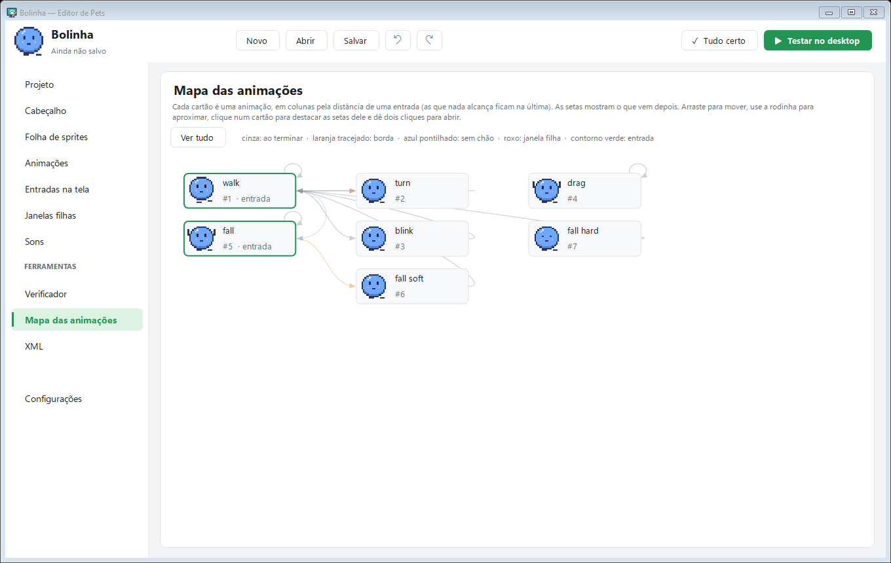
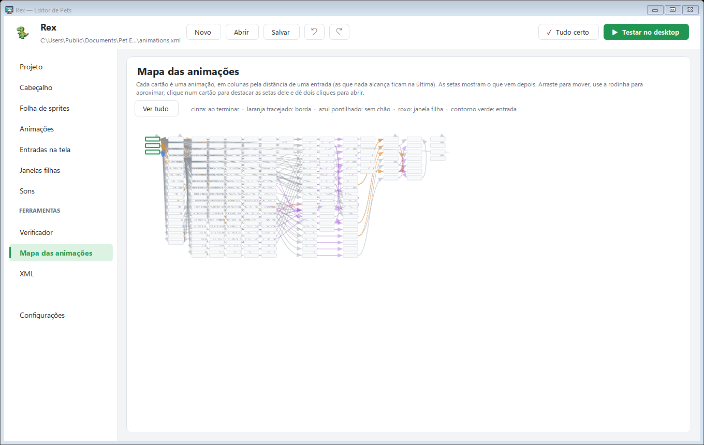

# Mapa das animações

[← Início do wiki](Home.md) · [English](../Animation-map.md)

Cada animação como um cartão, e setas para o que vem depois. Mostra num relance como o pet passa de uma animação para
outra, e o que nada alcança.

- Os cartões ficam em **colunas** pela distância de cada animação até uma entrada: a primeira coluna é com o que as
  [entradas](Entradas.md) começam, a seguinte é aonde essas levam, e assim por diante. As animações que nada alcança
  ficam na última.
- Um **contorno verde** marca uma animação com que uma entrada começa.
- As setas: **cinza** = ao terminar, **laranja tracejado** = borda, **azul pontilhado** = sem chão, **roxo** = janela
  filha.

| Mouse | O que faz |
| --- | --- |
| Arrastar | Move o mapa |
| Rodinha | Aproxima e afasta |
| Clique num cartão | Destaca as setas dele |
| Duplo clique num cartão | Abre a animação na página [Animações](Animacoes.md) |
| **Ver tudo** | Mostra o mapa inteiro |

Um pet grande (centenas de animações) faz um mapa grande: aproxime a parte em que está trabalhando.

