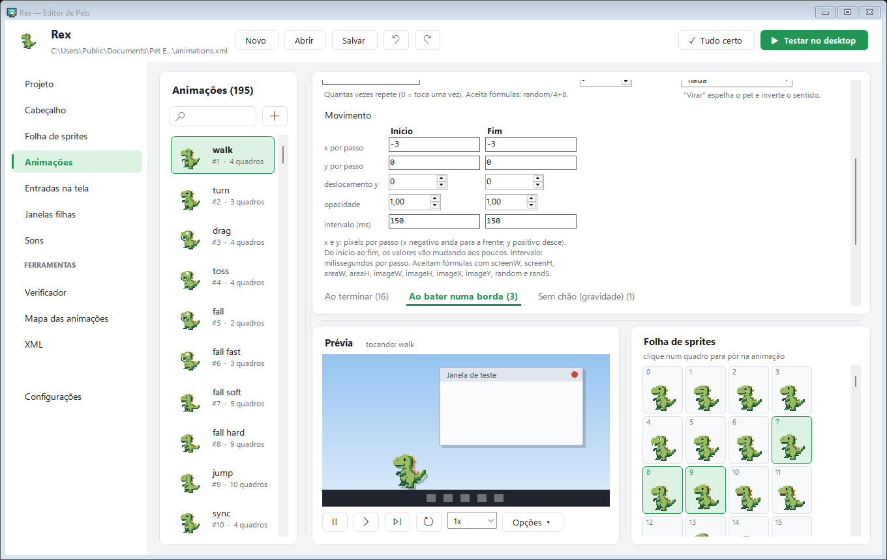

# Prévia

[← Início do wiki](Home.md) · [English](../Preview.md)

A prévia da página [Animações](Animacoes.md) toca o pet como o DesktopPet toca: ele anda, bate nas laterais, cai quando
fica sem chão, vira, abre as janelas filhas e passa de uma animação para a próxima pelas chances. Ela começa pela
animação escolhida e é atualizada a cada mudança.

Em cima: **tocando:** e o nome da animação que está no palco.

## Botões

| Botão | O que faz | Tecla |
| --- | --- | --- |
| ⏸ / ▶ | Pausar / continuar | `Espaço` |
| ❯ | Um passo (pausa e avança um passo de cada vez) | `→` |
| ⏭ | Próxima: termina esta animação e passa para a seguinte | |
| ⟳ | Do começo da animação escolhida | `R` |
| 0.25x … 2x | Velocidade | |

As teclas funcionam quando o cursor não está numa caixa de texto.

## Opções

| Opção | O que faz |
| --- | --- |
| **Repetir só esta** | Toca a animação escolhida sem parar, em vez de seguir para as próximas. |
| **Janela de teste** | Põe uma janela no palco: o pet pousa nela, anda em cima e bate nas laterais. Arraste-a pela barra de título. |
| **Quadro anterior** | Mostra o quadro anterior, transparente, por baixo do atual — para ver quanto cada quadro anda. |

## O mouse

Pegue o pet com o mouse: solte devagar para ele cair, ou jogue para arremessá-lo (ele voa e depois cai devagar ou com
força). As animações `drag`, `toss`, `fall soft` e `fall hard` tocam como no DesktopPet.

## Fundo e tamanho

Em [Configurações → Prévia](Configuracoes.md#prévia): o fundo (céu, xadrez ou escuro), o tamanho do pet (1x, 2x, 3x,
como a opção *escala* do DesktopPet) e se os sons tocam.

## Diferenças para o DesktopPet

A prévia é um palco do tamanho do painel, com uma barra de tarefas embaixo. Na área de trabalho de verdade a tela é
maior, há janelas reais e outros pets — use [Testar no desktop](Testar-no-desktop.md) para ver o resultado final.
