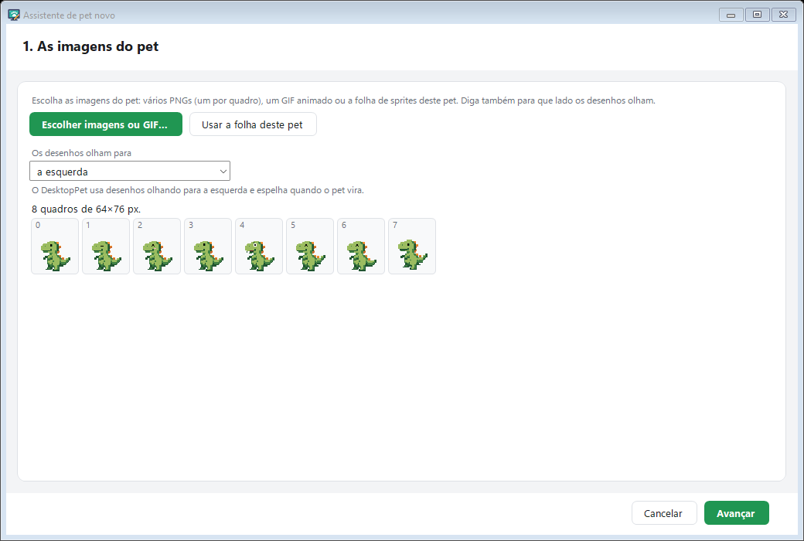
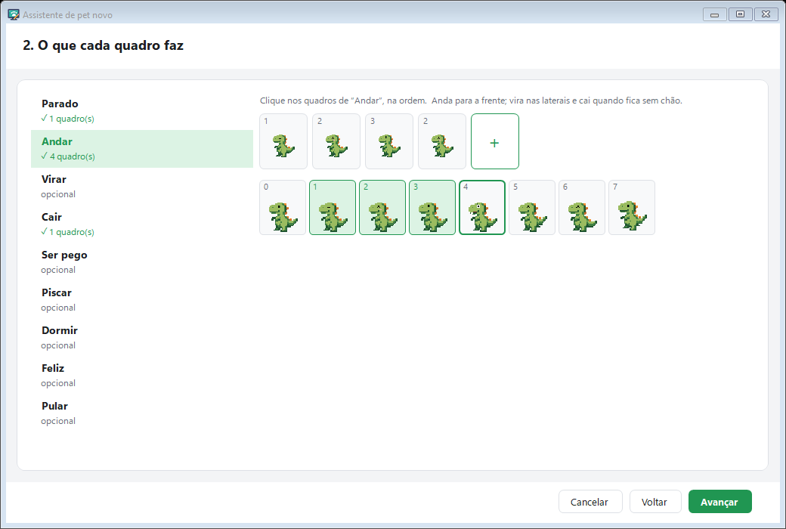
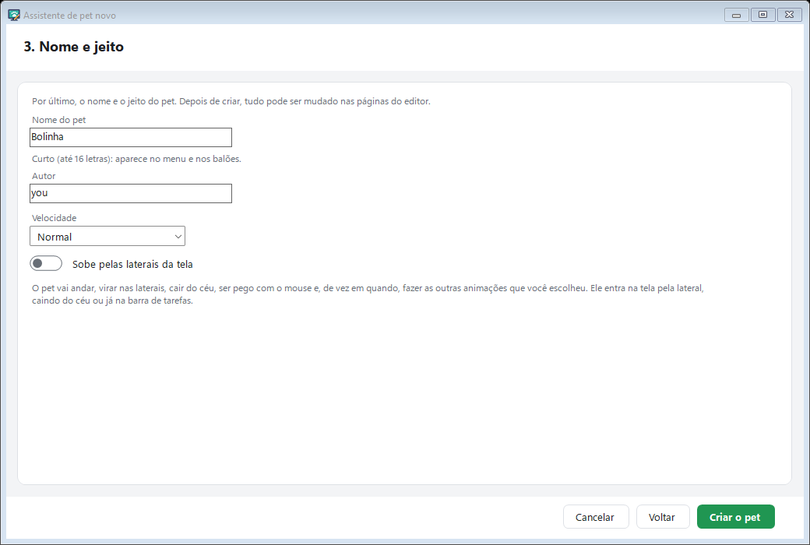

# Primeiros passos: o seu primeiro pet

[← Início do wiki](Home.md) · [English](../Getting-started.md)

Esta página faz um pet com as suas próprias imagens em poucos minutos, com o **Assistente de pet novo**.

## O que é preciso

Os desenhos do pet, de um destes jeitos:

- vários PNGs, um por quadro (por exemplo `andar_1.png`, `andar_2.png`…). Imagens com números no nome ficam na ordem
  dos números (`quadro_2` vem antes de `quadro_10`);
- um GIF animado;
- ou a folha de sprites do pet que já está aberto.

Imagens pequenas funcionam melhor (pets de área de trabalho costumam ter de 32 a 128 px de altura). Elas podem ter
transparência própria ou fundo **magenta** (`#FF00FF`), que some.

## 1. As imagens do pet

Abra **Projeto → Assistente de pet novo**, ou **Novo** na barra de cima → *Assistente de pet novo*, ou solte as imagens
na janela.

- **Escolher imagens ou GIF…** carrega as imagens; cada uma vira um quadro, centrada e com os pés embaixo. Se tiverem
  tamanhos diferentes, todos os quadros ficam do tamanho da maior.
- **Usar a folha deste pet** pega os quadros do pet que está aberto.
- **Os desenhos olham para**: o DesktopPet espera desenhos olhando para a **esquerda** e espelha quando o pet vira. Se
  os seus olham para a direita, escolha *a direita* e eles são espelhados para você.

Clique em **Avançar**.

## 2. O que cada quadro faz

À esquerda ficam os papéis. Escolha um e clique nos quadros dele na folha, na ordem. Um quadro pode ser usado mais de
uma vez (`1, 2, 3, 2` faz um andar suave). A faixa de cima mostra os quadros do papel escolhido: arraste um quadro para
mudar a ordem; o × dele tira.

| Papel | Precisa | O que o DesktopPet faz com ele |
| --- | --- | --- |
| Parado | pelo menos 1 quadro | fica parado um pouco e volta a andar |
| Andar | pelo menos 2 quadros | anda para a frente, vira nas laterais, cai quando fica sem chão |
| Virar | opcional | toca quando ele dá meia-volta |
| Cair | opcional | cai cada vez mais rápido até o chão ou uma janela |
| Ser pego | opcional | enquanto o mouse segura o pet |
| Piscar, Dormir, Feliz, Pular | opcional | de vez em quando, enquanto anda |

Um papel vazio pega quadros emprestados: *Ser pego* usa os de *Cair*, *Virar* usa o primeiro quadro de *Parado* e de
*Andar*, e *Cair* usa os de *Parado*. Piscar, Dormir, Feliz e Pular só são criados quando têm quadros.

## 3. Nome e jeito

- **Nome do pet**: curto (até 16 letras), aparece no menu do DesktopPet e nos balões.
- **Autor**: o seu nome.
- **Velocidade**: andar devagar, normal ou rápido.
- **Sobe pelas laterais da tela**: numa lateral da tela o pet sobe, e lá em cima solta e cai.

Clique em **Criar o pet**. O editor abre o pet novo na página [Animações](Animacoes.md). Ele já anda, vira nas
laterais, cai do céu, pode ser pego com o mouse e tem três [entradas](Entradas.md): entrando pela lateral, caindo do
céu e já em cima da barra de tarefas.

## Próximos passos

1. Veja-o na [prévia](Previa.md) e pegue-o com o mouse.
2. Clique em **Salvar** (`Ctrl+S`) e escolha uma pasta; o arquivo se chama `animations.xml`.
3. Clique em **Testar no desktop** (`F5`) para vê-lo de verdade ([Testar no desktop](Testar-no-desktop.md)).
4. Acrescente mais animações: o botão **+** da página Animações → *A partir de um modelo pronto…*
   ([Animações](Animacoes.md#animações-novas)).
5. Quando estiver pronto, [compartilhe](Compartilhar.md).
