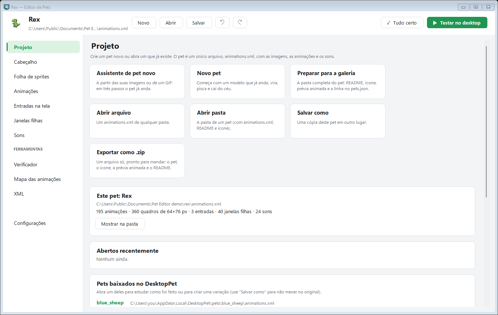
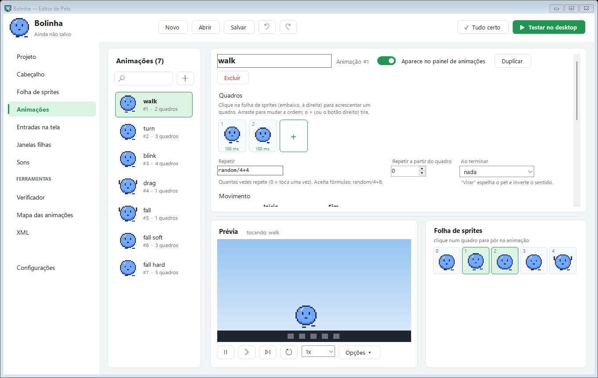

# Projeto

[← Início do wiki](Home.md) · [English](../Project.md)

Onde se começa: um pet novo, abrir um pet, salvá-lo em outro lugar ou compartilhá-lo.

## Os cartões

| Cartão | O que faz |
| --- | --- |
| **Assistente de pet novo** | Faz um pet a partir das suas imagens ou de um GIF, em três passos ([Primeiros passos](Primeiros-passos.md)). |
| **Novo pet** | Começa com um modelo que já anda, vira, pisca e cai do céu (uma bolinha azul chamada *Bolinha*). Troque as imagens dele na página [Folha de sprites](Folha-de-sprites.md). |
| **Preparar para a galeria** | A pasta completa do pet para uma galeria: README, ícone, prévia animada e a linha no `pets.json` ([Compartilhar](Compartilhar.md#preparar-para-a-galeria)). |
| **Abrir arquivo** | Qualquer `animations.xml`. |
| **Abrir pasta** | A pasta de um pet (a que tem `animations.xml`, README e ícone). |
| **Salvar como** | Uma cópia do pet em outro lugar; o editor continua com a cópia. |
| **Exportar como .zip** | Um arquivo só, pronto para mandar: o pet, o ícone, a prévia animada e o README ([Compartilhar](Compartilhar.md#exportar-como-zip)). |

Se o pet tem mudanças não salvas, *Novo*, *Abrir* e o assistente perguntam antes se é para salvar.

## Este pet

O arquivo do pet aberto e os números dele: animações, quadros (e o tamanho deles), entradas, janelas filhas e sons.
**Mostrar na pasta** abre o Explorador com o arquivo selecionado.

## Abertos recentemente

Os últimos 10 pets abertos, o mais recente primeiro. Clique num nome para abrir. *Configurações → Arquivos → Limpar a
lista de recentes* esvazia a lista.

## Pets baixados no DesktopPet

Os pets que o DesktopPet baixou neste computador (`%LocalAppData%\DesktopPet\pets`). Abra um para estudar como foi
feito ou para criar uma variação — use antes **Salvar como**, para o original continuar igual (o DesktopPet pode
atualizá-lo).
