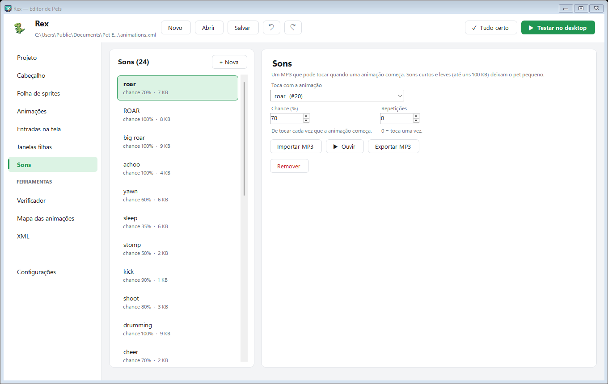

# Sons

[← Início do wiki](Home.md) · [English](../Sounds.md)

Um MP3 que pode tocar quando uma animação começa. O som é guardado dentro do `animations.xml`.

| Campo / botão | O que é |
| --- | --- |
| **Toca com a animação** | A animação que toca o som. |
| **Chance (%)** | De tocar cada vez que a animação começa (100 = sempre). |
| **Repetições** | 0 = toca uma vez. |
| **Importar MP3** | Escolhe o arquivo do som. Sons acima de uns 100 KB deixam o pet pesado; o editor pergunta antes de usar. |
| **Ouvir** | Toca o som. |
| **Exportar MP3** | Salva o som como arquivo. |
| **Remover** | Tira o som do pet. |

Sons curtos e leves deixam o pet pequeno: 64 kbps mono basta. O [otimizador](Compartilhar.md#otimizar-o-tamanho) e o
[Verificador](Verificador.md) apontam sons pesados. Na [prévia](Previa.md), os sons só tocam se
*Configurações → Prévia → Tocar os sons na prévia* estiver ligado.
