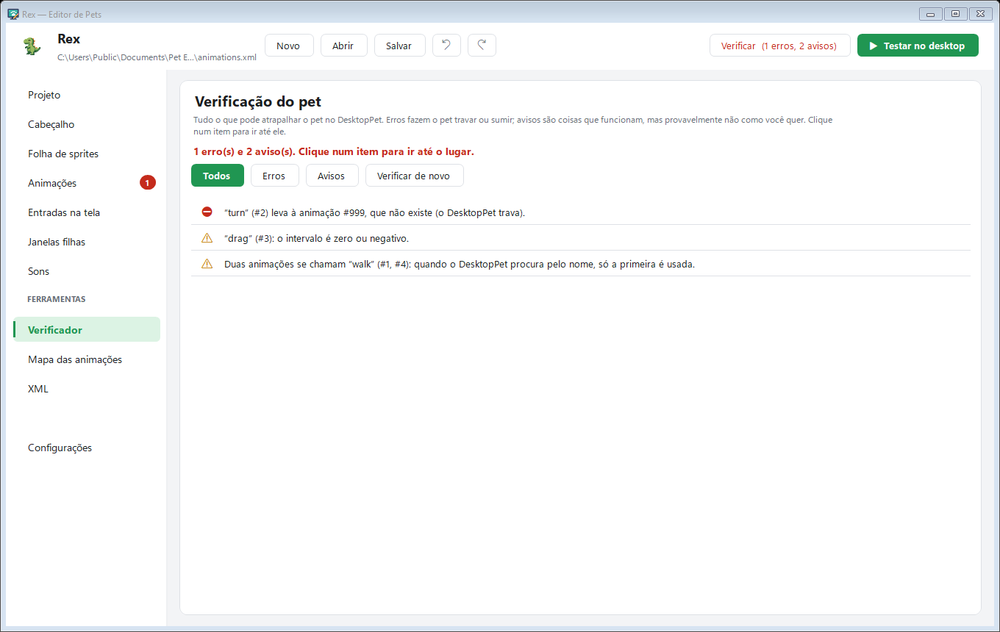
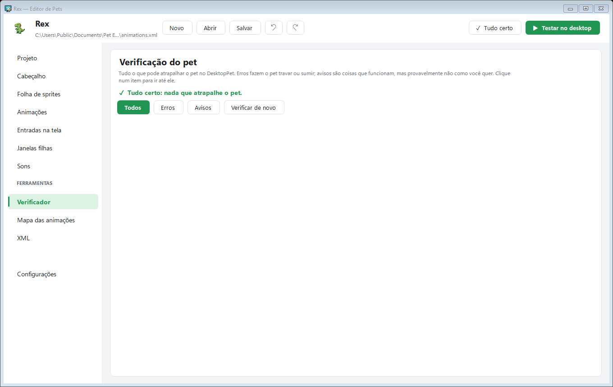

# Verificador

[← Início do wiki](Home.md) · [English](../Checker.md)

Tudo o que pode atrapalhar o pet no DesktopPet. **Erros** travam ou escondem o pet; **avisos** funcionam, mas
provavelmente não como você quer.

- A verificação roda sozinha um instante depois de cada mudança. O botão da barra de cima mostra o resultado
  (**Tudo certo** ou **Verificar (n erros, n avisos)**), a barra lateral mostra um número ao lado de cada página com
  problemas, e a lista de animações marca as animações com ⛔ / ⚠ ([A janela](A-janela.md#a-barra-lateral)).
- **Todos / Erros / Avisos** filtram a lista; **Verificar de novo** roda agora.
- **Clique num item** para ir até o lugar dele (a animação abre na página Animações).
- Ao salvar ou testar um pet com erros, o editor pergunta antes.

## Erros

| Mensagem | O que fazer |
| --- | --- |
| Falta a folha de sprites. | Importe uma na página [Folha de sprites](Folha-de-sprites.md). |
| Não há nenhuma entrada: o pet não aparece. | Crie uma em [Entradas na tela](Entradas.md). |
| Todas as entradas têm chance zero: o pet não aparece. | Dê chance a pelo menos uma entrada. |
| Não há animações. | Crie uma ([Animações](Animacoes.md)). |
| Duas animações com o número #n. / Duas entradas com o número #n. | Cada uma precisa do seu número (corrija no [XML](XML.md)). |
| A entrada #n começa com a animação #m, que não existe. | Escolha uma animação que existe. |
| *Animação* leva à animação #n, que não existe (o DesktopPet trava). | Corrija ou tire essa linha de *O que vem depois*. |
| *Animação* não tem quadros. | Clique em quadros da folha. |
| *Animação* usa o quadro *n*, mas a folha só vai até *m*. | Tire o quadro ou aumente a folha. |
| *Animação*: "repetir a partir do quadro" passa do último quadro. | Diminua o valor. |
| Uma janela filha é criada pela / toca a animação #n, que não existe. | Corrija a [janela filha](Janelas-filhas.md). |
| Um som toca com a animação #n, que não existe. | Corrija o [som](Sons.md). |
| *Lugar*: a fórmula "…" não funciona. | Corrija a [fórmula](Formulas.md) (a mensagem diz o porquê). |

## Avisos

| Mensagem | O que quer dizer |
| --- | --- |
| O pet não tem nome. | Preencha o [Cabeçalho](Cabecalho.md). |
| A imagem não se divide em *c* colunas × *l* linhas. | Ajuste colunas e linhas na página [Folha de sprites](Folha-de-sprites.md), senão os quadros saem cortados. |
| *Animação*: o intervalo é zero ou negativo. | Use milissegundos acima de 0. |
| *Animação*: todas as chances de "…" são zero, nenhuma é sorteada. | Dê chance a pelo menos uma próxima. |
| *Animação* não tem próxima: ao terminar, o pet reaparece em outro lugar. | Acrescente o que vem depois, se não for isso o que você quer. |
| *Animação* se move mas não diz nada para borda: o pet sai da tela. | Acrescente uma escolha em *Ao bater numa borda*. |
| *Animação* nunca é tocada (nenhuma animação ou entrada leva a ela). | Leve até ela a partir de outra animação, ou exclua. |
| Não há uma animação "drag" (ou "fall", "kill"…). | O DesktopPet usa uma simples ([nomes especiais](Animacoes.md#nomes-com-sentido-especial)). |
| Duas animações se chamam "…": só a primeira é usada. | Renomeie uma delas. |
| A janela filha que começa com "…" nunca termina. | Ela fica até o pet ir embora; dê um fim às animações dela. |
| O som de "…" tem *n* KB. | Deixa o pet pesado para baixar ([Sons](Sons.md)). |
| Quadros de *l*×*a* px são grandes demais para um pet de área de trabalho. | Diminua os quadros. |
