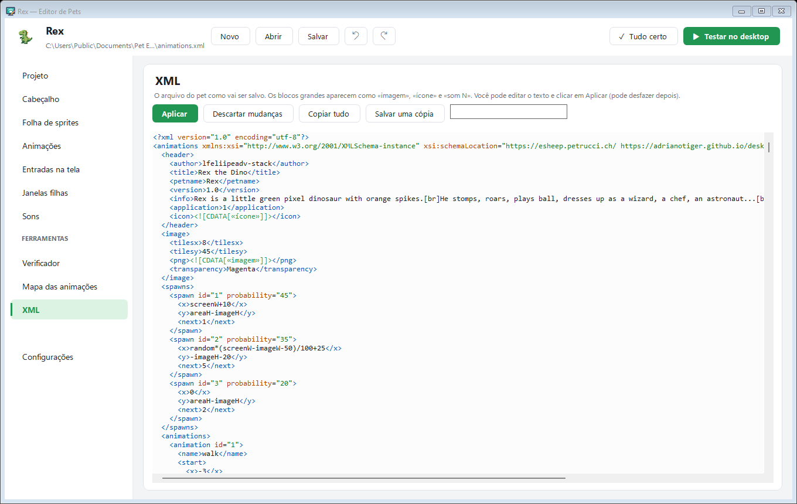

# XML

[← Início do wiki](Home.md) · [English](../XML.md)

O arquivo do pet como vai ser salvo, colorido e editável à mão.

Os blocos grandes (a imagem, o ícone e os sons, que são textos base64 compridos) aparecem como marcas curtas:
«imagem», «ícone» e «som N». Deixe as marcas como estão e os blocos originais são mantidos.

| Botão | O que faz |
| --- | --- |
| **Aplicar** | Lê o texto editado e troca o pet por ele (um passo que dá para desfazer). |
| **Descartar mudanças** | Mostra de novo o XML do pet, sem as suas edições. |
| **Copiar tudo** | Copia o XML inteiro, com os blocos de verdade, para a área de transferência. |
| **Salvar uma cópia** | Salva o XML num arquivo. |
| Caixa de busca | Digite e aperte `Enter` para achar a próxima ocorrência. |

Se você sair da página com edições não aplicadas, o editor pergunta se é para aplicar. Se o texto não for um XML de pet
válido, ele avisa e nada muda — confira as marcas `<` e `>` e os nomes das tags.

O que cada tag quer dizer está em [O formato do pet](Formato-do-pet.md).
